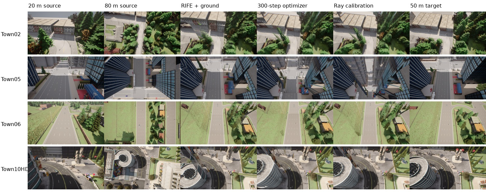
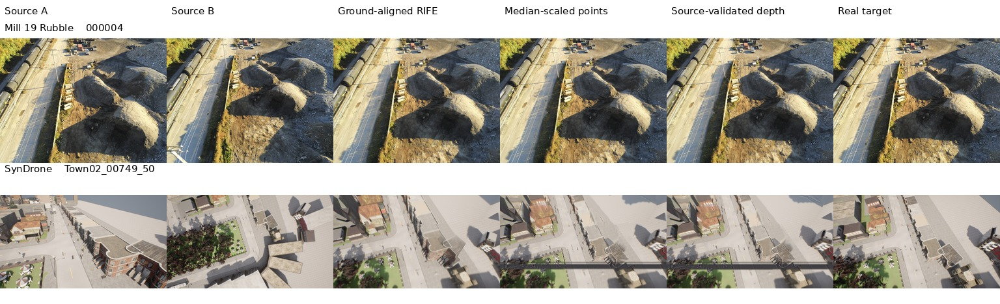

# 研究一 · 已知相机的双源新视角合成：射线标定与源图自校验

**投稿候选路线。** 两张源 RGB 加上源、目标相机参数即可运行。先沿已知相机射线拟合冻结网络预测的两幅三维点图，再用成功三角化的源间匹配校验深度形状与尺度，最后按目标视角的遮挡关系融合两张源照片。在开发后固定的 16 个新实拍机位与 12 个新模拟机位上，相对同一网络的简单中位数定标分别提高 0.169 与 0.715 dB，SSIM 和 LPIPS 的组均值也同时改善。这一新增实拍划分来自一个地点；模拟目标取自四个已用城市的新时刻。[主要复验原始数据](pointmap_summary.json)

**基础版本的机制与耗时。** 在两张带位姿的航拍照片上，冻结双视图网络，以两台相机的成像射线直接拟合三维点图的坐标变换，再从可见表面合成目标图像。当前最清晰的结果是，在 4 个新模拟城市的 12 组大幅俯仰变化上，几何估计时间的中位数从 5.638 秒降到 0.150 秒，约为原来的 1/37.5。同一渲染器下，PSNR 从 17.241 提升到 17.435 dB。两者均使用同一套 DUSt3R 权重。该计时仅覆盖输入张量准备、网络前向和深度恢复。读取文件、权重加载、两者共用的 RAFT 与渲染均在计时之外。在 12 个逐目标比较中，PSNR 与 SSIM 各赢 6 个，LPIPS 赢 9 个。Town02、05、06、10HD 的城市平均 PSNR 差分别为 −0.032、+0.358、+1.092、−0.639 dB；去掉 Town06 后其余三城平均为 −0.105 dB。[逐对耗时](syndrone_transfer/geometry_timing.json) · [逐目标与分地区对照](pointmap_summary.json)

对相同十二对图像另行计时，包含 RAFT、双源几何合成及输出一张目标 RGB 后，本方法中位数为 **0.536 秒**，官方优化路线为 **6.244 秒**，相差 **11.7 倍**。模型预载且源 RGB 已解码。两条路线交替执行，逐幅核对计时输出与评分图像相同，未把图像读取、PNG 写盘和冷启动计入。两种计时均来自单张 RTX 4090。[输入到目标 RGB 的逐对计时](syndrone_transfer/rgb_timing.json)

## 输入、已有技术与自行实现的部分

输入为两张 RGB 照片、两台源相机及目标相机的针孔内外参。真实测绘照片使用两源图的匹配校正遥测的水平尺度与朝向。精确模拟器相机直接使用公开标定。目标照片只用于评价。高度参考面须位于相机下方且所有视线俯向地面。此设定限定了开题研究一中已验证的部分，单张无位姿图和补全不可见建筑属于更广的任务。

1. 使用 DUSt3R 提供双向点图，分别以源图 A、B 为参考，各得到两幅像素网格在该参考系下的三维预测和置信度。[DUSt3R](https://arxiv.org/abs/2312.14132)
2. 在一个有尺度的相机坐标系中，每个观测像素都确定了一个相机中心和一条单位射线。令网络点为 q，中心为 c，射线方向为 r，估计变换 A、b，使 (I−rrᵀ)(Aq+b−c) 尽量接近零。先求共享尺度，把完整仿射变换弱正则到该尺度，以五次鲁棒重加权拟合全部源约束。将结果投至各相机光轴，按预测置信度合并两个输入次序。比较了强制共同尺度、七自由度相似变换、仿射变换及原网络的 300 步全局优化。刚体与点到射线标定本身有广泛先例，本工作的具体设计是对冻结双向点图做上述正则化拟合并把输出用于双源 NVS。[算法](../../relation_nvs/survey_pointmap.py) · [实验约定](protocol_pointmaps.md) · [相关点图重建工作 MASt3R-SfM](https://arxiv.org/abs/2409.19152)
3. 冻结 RAFT 估计双向对应，并依往返一致性融合可三角化的位置。在目标相机做显式深度缓冲，对可见表面混色；用单源逆采样恢复高频细节。另测试先将另一张照片按估计表面重投影，再让 RAFT 估计残差的变体。低通、深度缓冲、预变形和残差光流都使用已有技术原理。输出由本地渲染器生成，输入无需自然语言。[双目几何](../../relation_nvs/stereo_transport.py) · [渲染](../../relation_nvs/survey_visibility.py) · [PWC-Net 的预变形与光流](https://arxiv.org/abs/1709.02371) · [IBRNet](https://arxiv.org/abs/2102.13090)

## 六条真实测绘航线

四个地区等权。地区内先平均每条航线的逐目标差，再对航线等权，三个 Sheffield 航次合为一个地区。共同输入与目标用于每个配对，除 RIFE 只能比较 59 个机位外，表内其余比较覆盖 62 个机位。差为“射线仿射标定减去对照”。PSNR、SSIM 正值更好，LPIPS 负值更好。

| 对照 | ΔPSNR dB | ΔSSIM | ΔLPIPS |
|---|---:|---:|---:|
| 地面预对齐 RIFE | +0.214 | +0.0099 | −0.0179 |
| DepthSplat DL3DV 加统一地面底图 | +0.610 | +0.0465 | −0.0706 |
| 已知内外参 MapAnything 的原生度量深度 | +0.663 | +0.0179 | −0.0229 |
| 同一 MapAnything 深度配双目中位数定标 | +0.362 | +0.0164 | −0.0069 |
| 同精度 MoGe 单目深度配双目中位数定标 | +0.149 | +0.0058 | −0.0015 |
| 同一 DUSt3R 点图配双目中位数定标 | +0.024 | +0.0012 | +0.0005 |
| 同一点图和射线配七自由度相似变换 | +0.048 | +0.0022 | +0.0003 |
| DUSt3R 官方已知位姿全局优化 | +0.026 | +0.0032 | +0.0013 |

相对官方优化，四地 PSNR 差依次为 Monterey +0.074、Sheffield +0.010、Noema +0.079、Sand Key −0.059 dB。实拍对照显示同一网络下的质量差很小。和历史单目结果比较为 +0.127 dB，上表使用重跑且与点图实验相同的 TF32 配置。Monterey 与 Noema 的源图高 341 像素，官方优化器为保留方像素标定在上下补边，解析标定沿用网络输入的最近 16 像素倍数。其余航线与模拟器的尺寸无需此项差异。[分地区与配对记录](pointmap_summary.json)

MapAnything 允许向网络直接输入两台相机的内外参。使用公开权重、原版推理与统一渲染器后，本方法相对经中位数定标的 MapAnything 在四个实拍地区的 PSNR、SSIM、LPIPS 均占优。另将仿射射线拟合直接施加于 MapAnything 自身的点图。相对其原生深度，实拍地区平均提高 0.036 dB；相对同一模型上简单的双目中位数定标，降低 0.265 dB，LPIPS 恶化 0.0144。由此应把贡献限定在所测的双向 DUSt3R 点图与渲染流程，另一套点图的模型结构、掩码与方向次数均有所不同。补做中位数对照的时点已经记录。[MapAnything](https://map-anything.github.io/) · [固定版本与对照约定](protocol_mapanything.md)

## 官方优化的计算预算

用相同已知相机初始化、同一学习率与渲染器，将官方优化缩短至 1、10 和 30 步。十二组 SynDrone 迁移目标中，三个预算的 PSNR 分别为 16.351、16.896、17.210 dB，300 步为 17.241 dB，射线标定为 17.435 dB。十六组 Mill 19 首批目标分别为 24.165、24.199、24.538、27.419 dB，射线标定为 27.319 dB。于是降低官方迭代次数能缩短时间，但两组数据对短预算的敏感性不同。37.5 倍和 11.7 倍均是相对 300 步的配对计时。[短预算算法](../../tools/benchmark_survey_global_alignment.py) · [计算预算和全部指标](pointmap_summary.json)

## 同时改变高度与俯仰

SynDrone 在同一时刻有三架虚拟相机，20 米时俯角 30°、80 米时垂直向下、50 米目标时俯角 60°。先在 Town01、03、04、07 各一组已使用过的样本上查机制，再在另外四城各三个预先指定的时刻上复验。后十二组目标在该实验选帧时尚未取图，均完整保留。同一模拟器中的城市迁移只能说明这一数据来源上的泛化。[预定取样](protocol_syndrone_transfer.md) · [城市与原文件摘要](syndrone_transfer_cases.json)

| 十二个新目标，全图 | PSNR ↑ | SSIM ↑ | LPIPS ↓ |
|---|---:|---:|---:|
| 原始 RIFE | 13.791 | 0.3198 | 0.5496 |
| 地面预对齐 RIFE | 16.596 | **0.5498** | **0.3078** |
| DepthSplat 配平面底图 | 15.793 | 0.4815 | 0.4418 |
| 已知相机 MapAnything 原生深度 | 14.758 | 0.3900 | 0.4648 |
| MapAnything 点图配射线标定 | 15.440 | 0.4296 | 0.4216 |
| MapAnything 深度配双目中位数定标 | 16.293 | 0.4643 | 0.3630 |
| 同精度 MoGe 中位数 | 17.294 | 0.5214 | 0.3325 |
| 同一点图取中位数尺度 | 17.058 | 0.5065 | 0.3277 |
| 同一网络官方 300 步优化 | 17.241 | 0.5011 | 0.3361 |
| 七自由度射线标定 | 17.313 | 0.4985 | 0.3374 |
| 仿射射线标定 | 17.435 | 0.5134 | 0.3275 |
| 仿射射线标定，再按估计表面匹配 | **17.492** | 0.5314 | 0.3207 |

在原四城开发组，把工作区已保存的 ViewCrafter sparse RGB 分支第 12 帧与当前方法放到同一 512×288 栅格。逐例核对两幅源图散列、三台相机和历史生成帧。ViewCrafter 平均为 16.489 dB、0.4614 SSIM、0.3341 LPIPS，本方法为 17.303 dB、0.4837、0.3597。扩散方法在感知距离上占优。旧报告采用 256×144 评价，此处数字只可在本次相同栅格内比较。两条路线使用同源图片，原生推理尺寸和生成帧数各异。[四个逐目标结果](syndrone_heights/viewcrafter_scores.json) · [ViewCrafter 原始协议](../relation_nvs_20261120/ViewCrafter同输入对照与下一步研究.md)

在原四城的八幅源图上，用实际送入渲染器的深度计算，DUSt3R 中位数版的平均 AbsRel 为 0.138，仿射射线版为 0.106，官方优化为 0.108，MoGe 中位数为 0.121。δ<1.25 指标上官方优化更好，约 89.7% 对 86.2%。这能直接检验几何变化。附加双向匹配约束对该深度指标的改善接近零。[已封存深度与八幅误差明细](syndrone_heights/source_depth_scores.json)

在十二目标上，表面重匹配相对仅做射线标定增加 0.057 dB，SSIM 增加 0.0179，LPIPS 降低 0.0068。在六条实拍航线上，表面重匹配相对仅标定的地区等权差为 −0.044 dB、−0.0025、+0.0011。若两种预对齐都与原始光流进行相同的光度与往返一致性选择，实拍的表面对地面差只有 +0.002 dB。主路线保留原始匹配；表面重匹配作为大俯仰差的单独变体。[消融协议](protocol_surface_rematch.md) · [十二目标配对结果](syndrone_transfer/rematch_scores.json)



## 开题中的静态有效区域

使用官方语义类和深度建立同一套静态目标像素掩码。PSNR 只在掩码内计算，SSIM 只统计整个 11×11 高斯窗口位于掩码内的位置。可见性使用模拟器目标深度与两个源深度独立判定。这个诊断在看到全图分数后增加。平均约 91.7% 的整幅画面属于所定义的静态有效区。[静态评测约定](protocol_height_static.md) · [各机位及各可见区域结果](syndrone_transfer/static_region_scores.json)

| 十二目标 | 静态 PSNR ↑ | 静态窗口 SSIM ↑ | 全图 LPIPS ↓ |
|---|---:|---:|---:|
| 地面预对齐 RIFE | 16.65 | 0.565 | 0.3078 |
| 官方 300 步优化 | 17.17 | 0.504 | 0.3361 |
| 仿射射线标定 | 17.56 | 0.526 | 0.3275 |
| 按估计表面再匹配 | 17.62 | 0.544 | 0.3207 |

表面重匹配在仅一张源图可见的静态区域取得 18.43 dB，预对齐 RIFE 为 17.16 dB。两源同时可见区的静态窗口 SSIM 分别为 0.769 与 0.828。前者更准确地放置了部分只能从一张源照片取色的结构，同时仍有可以由源照片解释的纹理损失。

## 新实拍场景与源图自校验

追加 Mill 19 Rubble 实拍场景。它有 1,678 张已注册照片，采用公开的 COLMAP 相机，双源与留出的目标按距离、朝向、插值位置选取。首批 210 个保留相机中有 203 个满足条件，从中等间距取 16 个。用两张源图的 SIFT 匹配估计参考地面，所有方法共享坐标和面积采样。首批的两源光轴夹角中位数 0.13°，源基线除以平均离参考面高度的中位数为 0.265。该组主要检验航拍平移。相机是从公开整场景重建取得，合成器只用指定两张图与给定相机。实际离地米数未知。[原始采集 Mega-NeRF](https://github.com/cmusatyalab/mega-nerf) · [划分及坐标约定](protocol_mill19_rubble.md) · [逐目标相机与源图文件](mill19_rubble_cases.json)

首批 16 个目标中，仿射射线为 27.319 dB，官方 300 步为 27.419 dB，简单中位数为 27.773 dB，MapAnything 加中位数为 26.789 dB，预对齐 RIFE 为 26.236 dB。由于匹配可给出足够可靠的局部尺度，进一步检验能否只依据源观测确定深度表面的形状与尺度。

**源图自校验。** 从 RAFT 匹配中保留往返一致且可稳定三角化的源点。对每一张源图，比较四种深度：原始射线标定、用可靠点定标的自参考深度、用可靠点重新定标的射线深度、两种形状在对数深度中的鲁棒加权和。将源图按棋盘格分为两个空间子集，交替拟合并在留出子集检查误差，再用全部可靠点重估获选模型。两台源相机分别选择。匹配不足时保留射线估计。新设计与完整实现、实验约定和实验前固定的源码摘要均已保存。[深度拟合代码](../../relation_nvs/survey_pointmap_fit.py) · [预定比较及新图取样](protocol_pointmap_source_fit.md) · [代码摘要](protocol_pointmap_source_fit_hashes.json)

首批 Rubble 上，自校验得到 27.802 dB。一律给射线深度重新定标便能达到 27.717 dB，显示此处的主要变化来自尺度校正。首批 SynDrone 跨城组的三个结果分别是原始射线 17.435 dB、重新定标 17.466 dB、自校验 17.440 dB。以上两组已经用于提出该机制。

## 固定方法后的 28 个新目标

Rubble 新组按不同偏移留出 16 台目标相机，三个角色合计 48 张照片与首批完全无重叠。四个 SynDrone 城市各取三个此前未使用的时刻。每行按该组目标等权，PSNR 的单位为 dB。[实拍划分与相机](mill19_rubble_repeat_cases.json) · [模拟城市帧与文件摘要](syndrone_repeat_cases.json) · [逐目标指标及配对胜数](pointmap_summary.json)

| 方法 | Rubble PSNR ↑ | SSIM ↑ | LPIPS ↓ | SynDrone PSNR ↑ | SSIM ↑ | LPIPS ↓ |
|---|---:|---:|---:|---:|---:|---:|
| 地面预对齐 RIFE | 26.471 | 0.7876 | 0.1135 | 14.700 | **0.4867** | 0.3506 |
| DUSt3R 简单双目中位数 | 27.306 | 0.8230 | 0.0991 | 16.253 | 0.4568 | 0.3515 |
| DUSt3R 官方 300 步 | 27.175 | 0.8122 | 0.0997 | 16.403 | 0.4621 | 0.3470 |
| 射线标定 | 26.893 | 0.8077 | 0.1008 | 16.953 | 0.4851 | 0.3364 |
| 射线标定后统一用双目中位数再定标 | **27.491** | 0.8282 | 0.09834 | 16.877 | 0.4866 | 0.3359 |
| 射线标定及源图自校验 | 27.475 | **0.8283** | **0.09832** | **16.968** | 0.4855 | **0.3352** |

相对简单中位数，实拍 16 例中 PSNR 赢 8 例，逐例 PSNR 差的中位数为 +0.001 dB，SSIM 和 LPIPS 分别赢 11 例。模拟 12 例中 PSNR、SSIM、LPIPS 分别赢 11、10、11 例，逐例 PSNR 差的中位数为 +0.554 dB，四个城市的 PSNR 平均差均为正。相对官方 300 步，两组的 PSNR 平均差为 +0.300 和 +0.565 dB，分别赢 12/16 和 6/12。与 RIFE 对比，模拟组的平均 SSIM 低 0.0012。

完整自校验版在 16 组新实拍输入上的逐对计时中位数为 **0.730 秒**，官方 300 步为 **6.503 秒**，约快 **8.9 倍**。十二组首批模拟迁移目标中，对应时间为 0.549 与 6.089 秒，约快 11.1 倍。均从已解码的两源 RGB 和预载权重计至一张目标 RGB，包含匹配、标定、场景建立和渲染。计时使用单卡，报告两种方法各自的中位数之比，所有输出逐像素对上评分图。[实拍逐对计时](mill19_rubble_repeat/source_fit_rgb_timing.json) · [模拟逐对计时](syndrone_transfer/source_fit_rgb_timing.json)

可以直接核对源图如何改变选择。Rubble 新组的 32 张源图中，13 张保留重新定标的射线形状、12 张混合两种形状、7 张选择自参考形状。在大俯仰差的 24 张模拟源图中，23 张采用原始射线深度。选择机制相对只给射线深度重新定标，实拍降低 0.015 dB，两项感知指标近乎相同；模拟提高 0.091 dB 但 SSIM 降低 0.0011。该对照限定了复杂选择步骤的独立收益。[实拍选择记录](mill19_rubble_repeat/pointmap_source_fit.json) · [模拟选择记录](syndrone_repeat/pointmap_source_fit.json)

在前期六条实拍航线上，源图自校验相对预对齐 RIFE 的四地区等权差为 +0.223 dB、+0.0110 SSIM、−0.0176 LPIPS，相对经中位数定标的 MapAnything 为 +0.370 dB、+0.0176、−0.0067。相对同一 DUSt3R 的简单中位数仅为 +0.032 dB、+0.0023、+0.0007。实拍地区内的方法排序有变化。[完整地区与基线分数](pointmap_summary.json)



## 复现与投稿判断

在仓库根目录运行以下示例。普通入口接收两幅源 RGB 与相机 JSON，对多个目标可复用同一次几何估计。

```bash
export PYTHONPATH=. OPENBLAS_NUM_THREADS=1 OMP_NUM_THREADS=2
survey_py=/autodl-tmp/DroneVisCrt/envs/viewcrafter/bin/python
"$survey_py" -m tools.render_aerial_mosaic outputs/aerial_mosaic_validation/example_input.json /tmp/nvs_rays_demo --method surface_pointmap_rays
"$survey_py" -m tools.benchmark_survey_pointmaps generate syndrone_transfer
"$survey_py" -m tools.benchmark_survey_pointmaps score syndrone_transfer
"$survey_py" -m tools.benchmark_survey_global_alignment syndrone_transfer
"$survey_py" -m tools.benchmark_survey_rematch generate syndrone_transfer
"$survey_py" -m tools.benchmark_survey_rematch score syndrone_transfer
"$survey_py" -m tools.benchmark_survey_similarity syndrone_transfer
"$survey_py" -m tools.profile_survey_pointmap
"$survey_py" -m tools.profile_survey_pointmap --render-rgb
"$survey_py" -m tools.render_aerial_mosaic outputs/aerial_stereo_study/syndrone_transfer/example_input.json /tmp/nvs_source_fit_demo --method surface_pointmap_source_fit
"$survey_py" -m tools.benchmark_survey_pointmap_fit mill19_rubble_repeat syndrone_repeat
"$survey_py" -m tools.profile_survey_pointmap --source-fit --group mill19_rubble_repeat
survey_extra=/autodl-tmp/DroneVisCrt/envs
PYTHONPATH=.:$survey_extra/survey_mapanything_packages:$survey_extra/survey_mvsplat_packages "$survey_py" -m tools.benchmark_survey_mapanything --scale-control syndrone_transfer
```

**投稿判断。** 已经形成可以面向 ICML 撰写的效率与质量主张。在两张带已知相机的照片上，拟合冻结点图只需求解小型线性系统，现有源间匹配足以在部分场景纠正其尺度。相同基线、相机输入、渲染器和评价目标下，已测得计算量与画质的实际取舍。与简单中位数、官方短预算和完整优化的对照可以检验这项贡献。若将核心主张写成“普遍提升新视角画质”或“源图模型选择本身带来主要收益”，现有证据不足。公开点到射线几何和光流均有长期先例；论文的新颖性应落在这种双源标定、观测校验及其效率表现。两批新的实拍机位都来自 Pittsburgh 的同一地点，地面上方的双源相机设定也限定了结论的覆盖面。跨视角关系标注、图文扩增和单图无位姿生成各自需要直接评价。[完整早期实验](研究一_双源几何校验的新视角合成.md) · [15 项回归测试](pointmap_tests.log) · [普通入口的实拍运行记录](example_mill19_source_fit/manifest.json)
