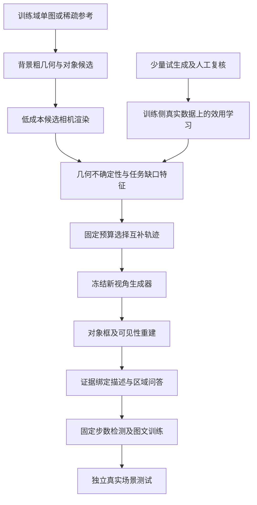

# 面向无人机巡检的预算约束视角生成与图文样本扩增：研究与实验方案

日期：2026-10-15。依据《无人机巡检多模态智能体开题报告_修订版》及本轮用户确认条件制定。

**资源边界：单张 RTX 4090 24GB；当前不能新增带相机参数的同场景无人机实拍多视角数据。** 本文给出待实施研究，所有规模、时间、超参数和通过条件均为建议，不是已完成结果，也不构成录用保证。方案以研究点一独立成文，围绕方法贡献与真实测试证据提高投稿竞争力。

## 1. 结论与选题

建议选题：**面向无人机巡检的训练效用预测驱动视角生成与证据绑定图文扩增**。

英文工作题目：**Learning to Generate Useful Views: Budgeted Image–Text Augmentation for UAV Inspection**。

一句话研究问题：**在生成、标注和训练预算有限时，能否在扩散生成之前预测哪些相机轨迹能补足真实巡检模型的能力缺口，从而用更少的合成样本改善真实航拍检测与区域文本理解？**

核心方法是一个生成前的、目标相关的视角选择机制。粗几何给出候选可行性；通过少量试生成与真实训练侧反馈学习“几何条件→生成后训练效用”的预测；以集合覆盖目标选择互补轨迹；对选中的生成图重新建立对象框和有区域证据的文字监督。使用冻结生成器，方法重点落在训练效用预测与预算内选择，不要求从头训练扩散模型。

这比“生成更多图片”更适合形成论文问题，也比固定的可见性、尺度、夹角加权更有可检验的机制。但梯度效用、子集选择、几何约束和证据标注分别已有研究，**组合本身不能自动成立为创新**。必须通过与通用数据选择方法、原报告评分式及最新航拍数据生成方法的比较，证明生成前的跨视角效用预测提供额外价值。

## 2. 与开题报告的对应关系

页码采用 PDF 阅读器页码；PDF 正文印刷页通常少 1。

| 报告位置 | 原始任务或设定 | 本方案落实方式 |
|---|---|---|
| PDF 第 2、5、22 页 | 道路/园区人员、车辆、障碍物检测，基于区域规则的风险分级 | 检测为主要终点；区域文本定位为图文终点；固定规则风险评价为辅助终点 |
| PDF 第 22–23 页 | 单图/稀疏图同场景新视角，固定预算目标相关选择 | 生成前预测训练效用，选择互补轨迹 |
| PDF 第 25–28 页 | MatrixCity 验证几何，VisDrone 验证真实检测 | 保留两条验证线；不得用合成域指标替代真实收益 |
| PDF 第 28 页式 (4.6) | 可见性、目标尺度、视角覆盖的固定加权 | 保留为必须超越的直接基线，而非新论文最终贡献 |
| PDF 第 28–29 页 | 生成后独立重标，固定比例与固定训练步数 | 保留，补充图文证据绑定和预算完整核算 |
| PDF 第 40–41、45 页 | 48GB 级显存、25 帧生成 | 按用户条件优先使用官方 16 帧版本，单卡实测后冻结 |

工作区原有“SkyDiffusion 地面到俯视图”相关文档是历史预研资料。当前报告明确选择 ViewCrafter 场景级 NVS；两条问题设定、相机控制和输入条件不同。SkyDiffusion 可列相关工作，适配到它的地空任务可作扩展，不能直接作为本任务同条件主基线。

本轮只围绕研究点一形成论文。参数持续适应、经验记忆和平台闭环可沿用报告协议作为后续研究，主论文中的检测器与规则评估流程保持固定，以利于收益归因。

## 3. 论文必须回答的三个假设

**H1：几何可行性与实际训练价值并不等同。** 看起来清晰、可见面积大的图，可能与已有训练样本重复；最大几何变化或最大模型不确定性，也可能对应目标破坏或噪声。

**H2：生成前的效用预测能够跨场景排序候选轨迹。** 在未用于拟合效用预测器的场景中，预测分数应与生成后短程训练带来的真实训练侧泛化改善相关，且在相同预算下优于原报告评分式。

**H3：对象证据约束的图文标注能把视角变化转成可靠监督。** 对象出画、遮挡或变得不可辨识时，描述与问答相应更新；加入合格图文样本应改善独立真实图像的区域文本定位，而非仅获得较高自动图文相似度。

目标贡献建议压缩为三项：生成前的视角效用学习；面向对象尺度/类别/遮挡缺口的预算集合选择；带证据区域的巡检图文实验协议与真实收益分析。证据绑定是数据构建机制，不额外扩张为独立的大型生成质量控制研究方向。

## 4. 数据配置与不可替代的边界

### 4.1 数据职责

| 数据 | 实际职责 | 不应作出的解释 |
|---|---|---|
| MatrixCity 公开 RGB、相机与 float32 深度 | 已知相机下 NVS、重投影与视角变化；优先选空间接近的保留目标视图 | 不是实拍 UAV；不默认包含充分人员/障碍物实例或风险标注 |
| VisDrone2019-DET | 真实人员/车辆检测主实验，沿用原始 10 类口径并另报巡检映射 | 二维框不提供真实相机高度、内参或区域规则 |
| VisDrone 公开视频任务子集 | 训练侧稀疏参考、区域图文补标与规则实验 | 相邻帧变化同时含动态对象运动，不能直接作静态 NVS 真值 |
| UAVDT | 独立真实交通域的迁移测试候选；类别映射后单独报告 | 不涵盖全部人员/障碍物任务；无标注类别不能记负例 |
| 自生成图 | 仅用于训练与生成诊断，明确父图和生成来源 | 不是同地点真实世界新增观测 |

**数据可用性核查是第一阶段任务。** 本轮没有下载并清点 MatrixCity、VisDrone、UAVDT，不应把上述计划数量写成已有数据。MatrixCity 的人物/车辆支持不足时，保留背景几何验证，目标保存与语义效用在人工复核的真实训练图衍生样本上评价；如需严格实例身份真值，再增加可控仿真静态快照，作为额外开发任务和成本，不将其视为公开数据现有字段。

### 4.2 两种划分协议

1. **标准基准协议：** 尽量保留 VisDrone 官方训练、验证、test-dev 职责。内部开发集只从 train 按场景分组留出；官方 val 用作固定测试，test-dev 做一次补充确认。若选择采用社区常见 train→val 调参方式，必须另留冻结测试，不能将已反复调参的 val 称为未见测试。
2. **严格场景隔离协议：** 对图像、视频、生成父图建立同地点/序列/近重复连通组；排查跨任务共享帧与跨官方划分疑似同地点，必要时移除训练侧冲突组。单独报告清理后的数量和结果，不能与官方全量榜单分数混用。

MatrixCity 按空间地块与视锥重叠构建场景组，参考报告的 100m 网格作为起点；缓冲区必须根据实际视野核验。源图、稀疏参考、目标图、所有裁剪与生成后代继承同组。测试目标 RGB、目标深度和目标标签只给评分器。测试时可以输入协议指定的参考图和目标相机，但不能把保留目标图布局输入生成器。

在训练集合内部进一步隔离三种职责：`real_core` 训练初始模型；`meta_proposal` 产生效用学习所需试生成样本；`meta_real` 提供真实训练侧效用目标。三者按场景分组；效用训练采用分组交叉验证。外部开发组只选择超参数，最终真实测试从始至终不参与候选排序、阈值和模型选择。

### 4.3 起步规模与标注账目

| 部分 | 建议起点 | 备注 |
|---|---:|---|
| 单卡可行性试运行 | 10 个训练参考场景，每场景 2 条轨迹 | 共 20 条；观察目标保留、显存和时延 |
| 效用校准候选池 | 约 40–64 个训练场景，每场景 4 条轨迹 | 共 160–256 条；每条预定保留 4 帧，640–1024 帧人工复核 |
| 每个正式生成策略 | 最多 100 个参考场景 × 3 条轨迹 | 300 条；16 帧完整输出共 4800 帧，预定 4 帧/轨迹，共 1200 帧进入标注/训练 |
| 真实图文与区域补标 | 起步约 600–1000 帧 | 按场景而非帧随机划分；用于文字监督、开发和冻结图文测试 |
| 规则风险验证 | 按报告最多 3000 帧的后续预算 | 首轮可只建立较小可行集，不能据小样本外推全部风险能力 |

效用候选池属于本方法额外投入，必须计入总成本。其生成图不能只额外加入本方法训练，而不提供给等数据对照；主比较可将同一个候选池作为所有组共享训练数据，或所有组都不加入最终训练，只供选择器拟合，并清楚标明。**每个策略的 1200 帧标注预算是逐策略成本，总人工量可能达到数千帧，不能把各组总成本写成 1200 帧。** 重叠候选可以缓存复用，按唯一图像/标签核算。

如果人工标注不足，先减少正式参考场景数并保证公平对照；不以未经复核的自动框补足金标准。

## 5. 方法：从可行视角到有用训练样本

### 5.1 输入、输出与两阶段选择

输入为训练场景参考图集合 \(I_r\)、参考对象标签/伪标签 \(O_r\)、相对或标定相机、冻结生成器 \(G\)、真实训练侧任务模型 \(f_\theta\)，以及生成预算 \(B_g\)、标注预算 \(B_a\)。输出为选中的相机轨迹及带对象、区域文字与来源记录的训练样本。

第一阶段在生成前选择轨迹，控制扩散调用。第二阶段在生成后按统一协议重建标注；所有组使用相同失败处理，避免靠本方法独有的反复重采样扩大实际预算。

### 5.2 粗几何与相机条件

沿用报告的 OpenCV 相机坐标与重投影形式：

\[
X_r=D_r(u)K_r^{-1}\tilde u,\quad
X_c=(T_{wc}^{-1}T_{wr})X_r,\quad
\tilde u_c\sim K_cX_c.
\]

使用 z-buffer 处理可见性。MatrixCity 的 NeRF 相机基变换、矩阵尺度和厘米 z-depth 按数据版本脚本核对；不能只对所有平移统一除 100。完成静态点与已知视图的重投影检查后再生成。

对真实未知位姿图，使用基线粗点云流程；稀疏图先掩蔽动态对象估计背景几何，再建立目标代理。单图估计的深度和焦距只提供相对坐标，半径变化是归一化比例，不能写成“从 20m 飞到 30m”。多参考视频中对象移动的实例不用于静态多视图对应；没有可靠对应时仅使用单图。

起步采用报告的 26 个非零相对相机终点：\(\Delta\theta\in\{-10,0,10\}^\circ\)、\(\Delta\phi\in\{-15,0,15\}^\circ\)、\(\Delta r\in\{-0.1,0,0.1\}\)。确认官方球面参数方向，并保存实际 4×4 相机矩阵作为依据。生成器的轨迹规划能力属于基线，本文新增的是训练任务驱动的选择目标。

每条候选轨迹预先确定 4 个保留帧。16 帧版建议零基索引 `[3, 7, 11, 15]`；25 帧版为 `[6, 12, 18, 24]`。避免近源帧大量重复进入训练。评价与选择都应考虑整条轨迹及保留帧，而非只看终点。

### 5.3 生成前能够获得的特征

候选轨迹 \(j\) 的特征 \(x_j\) 仅来自参考图、相机和粗渲染：

- 对象投影面积、短边分布、图像边界截断率、背景遮挡概率；分别对 person/vehicle/obstacle 聚合。
- 稀疏粗点、邻域地面与背景深度的可靠性，参考静态区域有效投影覆盖。
- 该视角是否补足训练域中缺少的“类别×尺度×遮挡×观测方向”组合。
- 原始训练模型在参考区域和粗渲染有效区域的特征、新颖度及不确定性；粗渲染孔洞不能直接解释成识别困难。
- 轨迹角度/位移、点云孔洞比例、相对可见性变化及估计生成/标注成本。

真实图的框内常含背景，不能将框内全部点当目标表面。优先用对象掩膜和邻域地面给出目标代理；无法可靠分离时扩大不确定性，标记缺失。可对深度尺度/焦距/点集进行小范围扰动或重采样，得到投影方差；扰动幅度由训练侧校准，不能宣称它是完全可信的贝叶斯后验。

报告中的静态覆盖 60%、尺度短边 [12,96] 像素仅作为基线起点；实际应统一到最终图像分辨率并在开发组校准。不能只选择大目标而使真实高空小目标能力退化。

### 5.4 用少量试生成学习预期训练效用

这是拟议核心，需要先验证其可学习性。

在 `meta_proposal` 场景中，以随机/均匀组合选择少量轨迹，真实运行生成器，对预定保留帧独立重标，得到 \((\hat I_j,\hat Y_j,\hat T_j)\)。在 `real_core` 训练的轻量模型上计算这些样本的训练梯度 \(g_j\)，并用场景隔离的 `meta_real` 计算真实任务损失 \(L_m\)。定义短程效用：

\[
u_j=L_m(\theta)-L_m(\theta-\eta g_j)
\approx \eta\nabla L_m(\theta)^Tg_j.
\]

正值代表该局部更新降低真实训练侧损失。该一阶近似不等于最终 mAP 提升，也不是新提出的梯度原理；它是构造轨迹效用监督的起点。为控制成本，优先只计算检测头/小型图文头梯度，或其固定低维投影；抽样候选做 10–50 步真实小模型更新，检查一阶排序与短程排序的相关性。最终完整模型实验负责检验真实收益。

图文头使用冻结图像/文本编码器、小型投影层和区域对比损失，可顺序运行于单卡。若联合检测与图文效用，采用

\[
u_j=u_j^{det}+\alpha u_j^{ground},
\]

两项先按训练侧尺度归一化，\(\alpha\) 由开发组确定。检测效用单独版本是必做消融；若图文效用不稳定，保留检测主选择、图文独立评价，并收窄贡献为图文样本构建，不宣称联合效用学习已成立。

训练小型回归器/排序器 \(h_\psi(x_j)\) 预测 \(\hat\mu_j\)。起步用带正则的 MLP 或树模型，不增加大型网络；用场景级重采样的多个轻量模型估计分歧 \(\hat\sigma_j\)，并拟合目标消失/身份错乱风险 \(\hat e_j\)。人工标注记录为风险监督，不把未匹配对象自动全记“丢失”。

特别注意：**部署到新的训练场景时，预测器只能读取生成前特征。** 不能在全部候选生成、人工标注后再选出最佳轨迹，却宣称节省生成预算。生成后才能计算的梯度值仅可用于效用学习和离线 oracle 对照。

所有效用标签、候选池生成、人工复核和代理训练成本单列。少样本实验中，还必须声明效用学习是否使用了额外真实标签；若使用完整标签训练选择器，只能称为“下游有限标签”而非严格端到端少样本。

### 5.5 在预算内选择互补轨迹

对候选轨迹定义保守效用

\[
a_j=\max(0,\hat\mu_j-\beta\hat\sigma_j-\lambda\hat e_j).
\]

从训练侧建立能力缺口原型集合 \(\mathcal D\)：例如“远距离小人员”“受遮挡车辆”“边界截断目标”。真实相机未知时，使用像素尺度与可观察属性定义缺口，不虚构真实高度。定义 \(k(j,d)\in[0,1]\) 为候选对缺口 \(d\) 的预计覆盖相似度。类别/尺度组合覆盖记为 \(r_{jq}\ge0\)。集合目标可设为

\[
F(S)=\sum_{d\in\mathcal D}w_d\max_{j\in S}[a_j k(j,d)]
+\gamma\sum_q v_q\min(1,\sum_{j\in S}r_{jq}).
\]

第一项避免反复选择同一种高分样本；第二项补足稀有类别与困难尺度覆盖。所有分数在一次选择开始前固定。硬约束包括：几何可行性、扩散调用数、保留/标注帧数、每场景最大轨迹数、最低类别覆盖等。

等成本主实验按边际增益贪心选择，先固定每场景轨迹数进行清楚归因；全局分配与不等标注成本作为增强实验。若成本不同，使用边际收益/成本排序或预算优化，并记录其与基数约束方法的区别。

可以给出的理论性质：在 \(w_d,v_q,a_j,k,r\) 均非负且固定时，上式是单调次模集合函数；只有在**单纯等成本基数约束**下，标准贪心才对应经典 \(1-1/e\) 近似结论。加入分区配额、双预算或变化分数后，不能直接沿用同一保证；更不能把集合代理目标的保证解释为真实检测 AP 保证。该性质用于说明去冗余机制，不能作为主要新颖性。

若效用预测器泛化不够，使用透明的几何/缺口评分继续做基线实验，并将效用学习标为失败结果；不要通过测试集重新拟合预测器。

### 5.6 生成后重建目标与图文标签

每个选中保留帧执行统一流程：

1. 几何框/跟踪/检测器提供候选，人工根据生成图实际可见轮廓重画框或掩膜；源图框不直接复制。
2. 记录对象类别、遮挡、可辨识性、是否出画；可可靠匹配时建立父实例关联，否则记 `identity_unknown`。
3. 建立对象与区域的结构化图：对象编号、类别、框、可见属性、二维相对关系、证据区域。
4. 从图构造描述、定位查询和问答，再可用固定 VLM 改写措辞；改写后逐断言核对，不能新增无依据属性。
5. 文字困难负例以改变可核查的类别/位置/关系得到；对象不可辨识时使用 unknown/省略，不能将未检出写成不存在。

例子：源图有车辆 A；新视角中 A 完全出画，则新图不得继承“左侧有一辆车”。源图车辆颜色不可辨识，不凭生成器补出的颜色宣称恢复真实车辆颜色。图像中新出现的虚构车辆可按画面重标用于一般检测训练，但它属于“生成新增实例”，不能算作参考目标保持成功，也不能支持同地点真实风险结论。

图文建议包含三个层次：全图简述；对象级 grounded phrase；区域问答。例如“图像右下方的一辆可见车辆”应绑定对象框，而“车辆占用消防通道”还需要合法区域、可判定的接触关系和规则输入，不能由图像描述模型自行赋予。

主实验**不生成合成风险等级训练标签**，延续报告边界。风险终点通过改善后的检测器和固定区域/规则链在真实标注图上评价。

### 5.7 下游训练

检测主模型保留 YOLOv8s，选择一个不同架构的可公开复现检测器作迁移验证，例如固定版本的 RT-DETR-R18；实际算力不足时先完成 YOLO 主线，第二模型为完整投稿证据的重要补充。

训练目标可写为

\[
L_{det}=L_{real}+\rho\,\mathbb E_{synth}[w_iL_{det}^{(i)}],
\]

其中主比较先令 \(w_i=1\)，避免把加权训练和视角选择效果混在一起；可靠性加权单独消融。真实/合成采样按固定训练比例、固定总优化步数执行，不能增加合成数据后仍按同样 epoch 训练而悄悄增加步数。

图文主任务采用区域文本定位：固定同一候选框协议，训练小型区域—文本对齐头。测试一张图和一条指代文本，输出匹配框。报告候选检测召回率、端到端定位成功率，以及真值候选框条件下的对齐上限；不能只使用真值框宣称完成端到端定位。冻结编码器和小头适合单卡；7B VLM 的量化 LoRA 只作为顺序运行的扩展。

## 6. 必须完成的实验矩阵

### 6.1 主对照

| 组 | 训练/生成策略 | 主要归因 |
|---|---|---|
| R0 | 真实数据，标准预处理 | 基础性能 |
| R1 | 真实数据 + 常规二维增强 | 强真实数据基线 |
| R2 | R1 + 定额重复采样/加权真实样本 | 数据曝光与难例重采样是否已足够 |
| G1 | R1 + 均匀轨迹生成 | 新视角扩增基本价值 |
| G2 | R1 + 随机可行轨迹生成 | 排除只挑选可行轨迹带来的效果 |
| G3 | R1 + 报告式 (4.6) 的 V/Q/D 评分 | 必须超越的直接研究基线 |
| G4 | R1 + 最大不确定性/训练缺口选择 | 是否只是困难样本偏好 |
| G5 | R1 + 通用覆盖/coreset 选择 | 是否只是去冗余 |
| G6 | R1 + 本方案预生成效用 + 集合选择 | 完整方法 |
| O1 | 生成全部小候选池后，用真实标签/短程效用挑选 | 昂贵离线上限，单列成本，不参加等生成预算排名 |

在校准小候选池上增加 GRAD-MATCH 等生成后数据选择对照：评估它与本方法效用代理的关系。它已看到生成图与标签，不能冒充等生成成本基线；另按完整成本比较其效率。AeroGen/InstaGen 类型方法是重要的“生成式检测扩增”外部基线，应在同一训练来源与标注预算下尽力适配。原论文不同数据集上的数值不直接抄入本表排名。

### 6.2 公平比较的三个视角

- **固定样本量：** 相同参考清单、相同候选、相同调用数、相同预定保留帧数；显示选择本身的作用。
- **固定标注量与训练步数：** 相同人工分钟/复核强度、相同最终合成样本数与优化步数；失败率不同会影响能否达到配额，公开缺额，不能无成本补采。
- **完整成本曲线：** 含效用学习前期投入，比较真实 AP/定位指标随累计 GPU 小时和人工小时的变化，报告达到某一性能所需成本及是否有盈亏平衡点。

前两者可能无法同时严格相等，应分别建表，不能用一个“等预算”概念覆盖所有资源。离线共享缓存池可用于选择算法对比，但不能证明在线生成成本降低。

### 6.3 核心消融

1. 固定手工评分 → 只学效用 → 效用加分歧惩罚 → 加生成错误风险 → 加集合覆盖。
2. 只选最高分 top-k 与集合选择；相同对象尺度分布重采样后再比较，排除只偏大目标。
3. 仅检测效用、仅图文效用、联合效用；没有图文数据、模板图文、自由描述、证据绑定图文。
4. 源图框直接继承、自动重检测、人工复核重建。前两者作为错误对照，人工真值用于独立评分。
5. 原始比例、0.25、0.5、1.0 的合成/真实样本比例；10%/25%/100% 标签量，额外监督账目完整公开。
6. 单参考与有可靠静态重叠的稀疏参考；真实深度条件/预测深度条件只在合成域分开评价，主部署不读取真值深度。
7. ViewCrafter_16 与另一可运行场景 NVS 生成器。优先评估 WAVE（ICCV 2025）或 Stable Virtual Camera（ICCV 2025）的公开权重、显存与相机接口，确认单卡可运行后冻结其中一个。若只有一个生成器，论文只能主张在该生成器下成立，不能宣称普适的生成器无关方法。

常规增强配置必须所有 G 组一致。若正则化、检测阈值、候选数量或图文标注器改变，应作为独立实验而不是隐藏改动。

## 7. 指标、统计和目标证据

### 7.1 主要指标

| 层次 | 主要指标 | 解释边界 |
|---|---|---|
| 真实检测 | 官方 10 类 AP、AP50、AP75、APsmall；person/主车辆映射指标；按遮挡/尺度分层 | 映射任务与官方任务不同，分别报告 |
| 障碍物 | 完整补标子集的 AP、召回、误检 | 障碍物非 VisDrone 原生类别；未补全标注的帧不作障碍物负例 |
| 图文 | 端到端区域文本定位 Acc@IoU≥0.5、候选框召回；断言精度—覆盖率 | CLIPScore 不作为事实正确性金标准 |
| 视角生成 | 已知位姿保留图上的静态 PSNR/SSIM/LPIPS、静态点重投影误差 | 粗点云自身重投影仅是流程检查，不证明最终扩散图遵从相机 |
| 对象保持 | 可对应对象的保留/出画/遮挡/消失率、类别与数量变化；人工审查身份 | 同数量不代表同身份，部分实例无从确认时记 unknown |
| 选择器 | 场景外候选效用 Spearman 相关、top-k regret、短程效用校准 | 真实效用只用于离线评分，不参与正式选择 |
| 风险辅助 | 固定规则下 Macro-F1、最高级风险召回、误报/百帧、unknown 覆盖 | 规则化事件等级不等于事故概率 |
| 成本 | 有效样本/生成调用、GPU 小时、人工分钟、失败/拒收/重采样率 | 前期校准、失败和额外标签全部计费 |

生成图相机遵从性还应检查最终图像中可识别静态地标/结构的对应，报告有效匹配率及失败比例；生成图与期望相机无法可靠匹配时不把它记为零误差。未知位姿真实图没有配对真值，不报告 PSNR/绝对姿态准确率。

障碍物先定义临时围挡/路障、散落物、堆置物等明确子类；不把常驻建筑和道路边缘统一当障碍物。所有入选帧需完整补标；不足时只给探索性结果，并明确主结论首先覆盖人车。

### 7.2 统计单位与结论

主组至少 3 个训练种子；生成噪声按父场景/候选映射，公共候选尽量共享缓存。以场景组作配对重采样，建议 1000–5000 次 bootstrap，报告 95% 区间、每种子结果和种子间标准差；相邻帧不能当独立重复。种子数仅 3 时不夸大推断精度；关键差异可增加 5 种子作为后续确认。

没有普遍适用的“提升几 AP 即达到 CCF-A”门槛。建议预登记的**工程决策目标**可设为：完整方法相对最强等预算选择基线达到约 1–2 个绝对 AP 点，或在接近性能下节省约 25%–30% 的生成/标注投入，同时小目标与图文主指标不明显退化。它只是判断是否值得投入后续实验的目标，不是预测结果或投稿资格线。即使平均提升较大，若只在一个模型/数据集成立，或没有统计与成本支持，也不能支撑广泛结论。

选择器预测相关性、生成后对象保持与真实 AP 改善应共同分析；不能只展示其中最有利的一条。

## 8. RTX 4090 24GB 实施配置

### 8.1 已核验的官方信息

ViewCrafter 官方 README 给出以下 **A100 40GB、50 DDIM 步**下的参考测量：

| 权重版本 | 官方分辨率/帧数 | 官方显存 | 官方单条推理时间 |
|---|---|---:|---:|
| ViewCrafter_25 | 576×1024，25 帧 | 23.5GB | 120s |
| ViewCrafter_16 | 576×1024，16 帧 | 18.3GB | 75s |
| ViewCrafter_25_512 | 320×512，25 帧 | 13.8GB | 50s |

以上不能换算成 4090 已测性能，也不保证端到端常驻多个模型时仍同样占用。官方还提示较新 PyTorch 可能造成 OOM，因此应使用独立环境并先固定兼容版本。

**建议主配置：官方 ViewCrafter_16、576×1024、50 步、逐帧 AE 解码、一次一条轨迹；先做 10 场景试运行。** 16 帧权重是官方消融版本，不能将它的结果标为完整 25 帧论文配置复现。空间分辨率优先保留，以免小目标先被缩小。25 帧高分辨率用于后续显存允许时的补充；320×512 为应急探索组，与主配置分别报告。

几何预测、视频生成、检测训练、图文训练顺序运行，必要时将中间数据落盘，不让多个大模型同时常驻。CPU offload、VAE 切片等工程选项先确认当前代码支持与输出影响，再使用；不能写成已实现功能。

检测起步 YOLOv8s、输入 960、混合精度；batch 按实测可用显存确定，推荐从 4 开始，梯度累积使有效 batch 保持一致。第二检测器使用适合单卡的版本。图文先缓存冻结编码器特征训练小头；VLM 自动初标分批离线，7B 量化与 LoRA 不作主线依赖。

### 8.2 成本估算方法

先实测单轨迹时间 \(t_g\)、几何/写盘时间、峰值 allocated/reserved 显存，重复运行给出中位数/P95。若 300 条轨迹每条 2–5 分钟，则单策略纯生成约 10–25 GPU 小时；**2–5 分钟是假设区间，不是实测或官方 4090 数字**。

完整规模包括：校准池 160–256 条；随机/均匀/原报告/完整方法等多策略各最多 300 条，重合部分缓存；核心 6–8 组 × 3 种子检测训练；图文与第二模型实验。总量可能达到数百 GPU 小时及数千帧复核，不应按一轮生成推断总工期。预算表应填实际吞吐后计算。

单卡并不阻止高水平方法研究，但更适合冻结大模型、学习小型选择器。需要额外大显存或算力时，优先补强生成器和第二模型对照，而非先训练新的大型视频扩散模型。

## 9. 分阶段实施与停止条件

时间从正式启动计，示例为约 4–6 个月研究周期；个人投入和人工复核能力将显著影响实际时长。

| 阶段 | 工作与交付 | 继续条件/失败处理 |
|---|---|---|
| 第 1–2 周 | 数据抽样、场景划分、20 条生成试运行、对象保持审查、真实基线 | 若主要目标大量丢失/不可辨识，先减小相机幅度，检查分辨率与对象代理；保留失败记录 |
| 第 3–5 周 | 随机/均匀/原报告评分对照，小规模独立重标，确认扩增是否可能有益 | 若真实 AP 与常规增强相比无收益，先排查标签与域偏移，不直接扩大生成 |
| 第 6–9 周 | 校准候选池、训练效用预测器、跨场景排序、短程更新诊断 | 若效用预测与实际收益没有稳定关系，调整训练侧目标；不靠最终测试改模型 |
| 第 10–14 周 | 固定预算完整选择、主检测组 3 种子、图文训练与消融 | 同时检查类别/小目标退化、真实定位收益、完整成本 |
| 第 15–19 周 | 第二模型、UAVDT 跨域、生成器迁移或更强生成对照 | 如迁移失败，收窄结论并分析原因 |
| 第 20–24 周 | 关键复核、论文、代码/清单与版本整理 | 投稿前完成最新相关工作差异核对，避免“首个”等未经证明的表述 |

最值得尽早做的否证实验：同一批训练参考，比较常规增强、均匀新视角、原报告评分选择；各组相同标注量与训练步数。如果两种新视角均不优于常规增强，应先验证小目标身份/标签与生成域差距。选择算法无法自动挽救完全失真的候选池。

## 10. 论文证据组织与投稿定位

建议论文主图围绕“有几何差异的视角不一定有训练价值”展示同源候选、预测效用、目标保留及真实困难集结果。主表报告等预算真实检测，第二表报告图文定位与断言可靠性，核心图报告效用校准、预算—性能曲线和错误模式；附录公开划分、标注细则、失败、完整成本和每种子结果。

CVPR/ICCV 适合较强的可推广视角选择与视觉生成方法；ACM Multimedia 适合有实质图文监督贡献的版本；TPAMI/IJCV 更适合进一步扩展到多任务、多生成器和充分泛化分析的成熟版本。CCF 等级以投稿时单位采用的正式目录为准；本轮访问 CCF 官网遇到验证页，不能宣称完成最新目录核验。不要将所有视觉/多媒体期刊统称 A 类。

本方案达到的是“可执行、可否证、面向高目标的研究设计”。能否投稿并被接收取决于实际新颖性、结果、论证和当时竞争工作。**仅冻结 ViewCrafter、加一个手工评分、重标后训练 YOLO，预计难以形成充分的方法贡献；如果效用预测能跨场景泛化、在完整成本下优于强基线，并改善真实检测与图文定位，才有较扎实的论文主张。**

## 11. 相关工作与核验范围

核验日期：2026-10-15。本轮读取报告全文并核对以下公开材料；网络搜索不是完整系统综述。2026 工作按实际读取到的 arXiv 或正式 CVF 页面区分预印本与会议论文，不由年份或书目索引推断录用。OpenAlex/Crossref 负责发现/书目信息，方法结论以作者摘要、官方仓库或论文原文为准。

1. **ViewCrafter**，TPAMI 2025：官方仓库 README 和 [arXiv 摘要](https://arxiv.org/abs/2409.02048)；[官方代码](https://github.com/Drexubery/ViewCrafter)，[DOI](https://doi.org/10.1109/TPAMI.2025.3613256)。已有场景 NVS 与相机轨迹规划，不能再把一般轨迹规划当新贡献。
2. **AeroGen: Enhancing Remote Sensing Object Detection with Diffusion-Driven Data Generation**，CVPR 2025：[CVF 正式页](https://openaccess.thecvf.com/content/CVPR2025/html/Tang_AeroGen_Enhancing_Remote_Sensing_Object_Detection_with_Diffusion-Driven_Data_Generation_CVPR_2025_paper.html)。本轮读取正式摘要，确认其包含水平/旋转框布局条件生成、多样性条件和筛选框架；因此“布局控制 + 合成数据筛选”不能作为本文充分新意。应继续精读与适配复现。
3. **InstaGen: Enhancing Object Detection by Training on Synthetic Dataset**，CVPR 2024：[CVF 正式页](https://openaccess.thecvf.com/content/CVPR2024/html/Feng_InstaGen_Enhancing_Object_Detection_by_Training_on_Synthetic_Dataset_CVPR_2024_paper.html)。正式摘要描述扩散模型的实例 grounding head、区域与类别文本对齐、检测器监督及自训练；不将“自动图像加框”或“区域文本对齐”当全新问题。
4. **GRAD-MATCH**，ICML 2021：[PMLR 原文页](https://proceedings.mlr.press/v139/killamsetty21a.html)。摘要明确涉及训练/验证梯度匹配与子集选择；本方案的一阶效用与子集思想应引用并比较，创新只能落在生成前的跨视角效用预测和预算机制。
5. **SemanticNVS: Improving Semantic Scene Understanding in Generative Novel View Synthesis**，2026 预印本：[作者摘要](https://arxiv.org/abs/2602.20079)。使用语义特征增强相机条件多视图生成；需要区分“生成语义一致性”和本文的“真实任务训练效用”。
6. **Stabilizing Camera-Controlled Novel View Synthesis at Inference Time**，2026 预印本：[作者摘要](https://arxiv.org/abs/2609.03639)。讨论小步相机运动与推理稳定性，不能把缩小角度本身当新方法。
7. **MatrixCity**，ICCV 2023：[官方仓库与数据说明](https://github.com/city-super/MatrixCity)。本轮读取相机约定、z-depth、单位和 float32 深度说明；不能照搬未经版本核对的缩放。
8. **VisDrone**：[官方仓库](https://github.com/VisDrone/VisDrone-Dataset)。本轮读取任务和公开划分说明，test-dev 标签可用；任务间共享帧与场景仍需实地清单核查。
9. **SkyDiffusion**，ICCV 2025：[正式论文](https://openaccess.thecvf.com/content/ICCV2025/html/Ye_Leveraging_BEV_Paradigm_for_Ground-to-Aerial_Image_Synthesis_ICCV_2025_paper.html)。工作区已有正式论文与核验记录，作为不同输入条件的相关工作；当前地空复现小样本不能替代本任务实验证据。
10. **WAVE: Warp-Based View Guidance for Consistent Novel View Synthesis Using a Single Image**，ICCV 2025：[CVF 正式页](https://openaccess.thecvf.com/content/ICCV2025/html/Park_WAVE_Warp-Based_View_Guidance_for_Consistent_Novel_View_Synthesis_Using_ICCV_2025_paper.html)。已读正式摘要，属于无训练的视角一致性生成路线；可作为第二生成器候选，但本轮未核验其单卡运行。
11. **Stable Virtual Camera: Generative View Synthesis with Diffusion Models**，ICCV 2025：[CVF 正式页](https://openaccess.thecvf.com/content/ICCV2025/html/Zhou_Stable_Virtual_Camera_Generative_View_Synthesis_with_Diffusion_Models_ICCV_2025_paper.html)。已读正式摘要，支持输入视图与目标相机条件的通用生成；应作为比旧基线更近期的比较对象评估。
12. **PR-IQA: Partial-Reference Image Quality Assessment for Diffusion-Based Novel View Synthesis**，CVPR 2026：[CVF 正式页](https://openaccess.thecvf.com/content/CVPR2026/html/Choi_PR-IQA_Partial-Reference_Image_Quality_Assessment_for_Diffusion-Based_Novel_View_Synthesis_CVPR_2026_paper.html)。正式摘要讨论无目标真值的生成后质量图与 3DGS 监督筛选；本文须通过生成前选择、真实检测训练效用和完整成本区分，不能仅以“跨视角质量评估”宣称创新。
13. **Learning from Synthetic Data via Provenance-Based Input Gradient Guidance**，CVPR 2026：[CVF 正式页](https://openaccess.thecvf.com/content/CVPR2026/html/Nagano_Learning_from_Synthetic_Data_via_Provenance-Based_Input_Gradient_Guidance_CVPR_2026_paper.html)。正式摘要利用合成来源区域做输入梯度监督以抑制背景偏差；与本方案参数梯度估计局部训练收益不同，但说明“来源信息 + 梯度 + 合成训练”也已有相关工作，需明确差别。

上述对比基于官方摘要与仓库，尚未逐篇完成全文复现。正式算法立项后，先为效用选择、生成前决策、相机条件、图文标注、真实下游与总成本六个维度建立差异表，再固定论文贡献表述。

投稿前还需扩展到最新 task-aware synthetic data、active view selection、data valuation、camera-controlled NVS 和 grounded captioning 文献，建立逐项差异表。本文不声称首创“效用选择”“证据约束”或“图文一致性”。

## 12. 可复现产物与最小字段

计划代码模块为 `prepare_data`、`build_geometry`、`render_candidates`、`calibrate_utility`、`select_trajectories`、`generate_views`、`rebuild_annotations`、`train_detector`、`train_grounder`、`evaluate`。它们属于待实现模块，本轮未创建可运行训练代码。

每条样本至少记录：`scene_group_id`、`source_dataset`、`split`、`reference_ids`、`reference_time`、`generated`、`camera_matrices`、`camera_convention`、`scale_status`、`geometry_source`、`generator_revision`、`seed`、`trajectory_id`、`retained_frame_index`、`selection_features`、`predicted_utility`、`selection_cost`、`object_boxes`、`visibility`、`parent_instance_match_status`、`grounded_assertions`、`annotation_source`、`review_status`、`ignore_regions`、`label_version`、`image_sha256`。

实验配置和矩阵随本方案另存为设计模板；正式实施后再填软件提交、权重摘要、实际规模、吞吐和预算。不能把模板字段或本文公式当作已有算法实现或实验结果。
