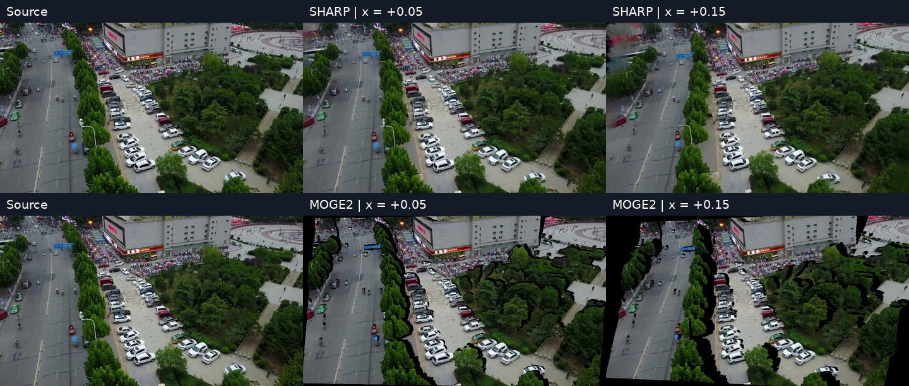
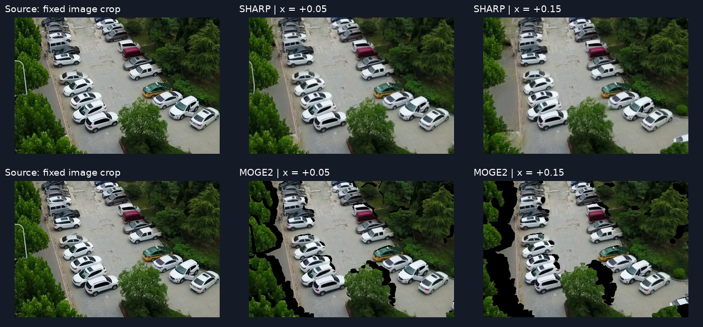

# 开源方法实际试跑报告：SHARP 与 MoGe-2

日期：2026-10-23。工作区：`/root/DroneVisCrt`。

## 1. 结论与对研究点一的建议

**已实际跑通两条路线，各完成 3 张真实航拍图和 1 张官方街景样例。SHARP 可以作为近视角扩增的快速基线；MoGe-2 更适合提供粗几何和可见性诊断。**

在这组样例中，SHARP 的画面连续性较好，小幅运动下停车场车辆仍较容易辨认；位移增大后，树木、建筑和图像边缘出现拉伸、模糊及局部形状变化。MoGe-2 的几何推理很快，但本轮采用的网格渲染在深度边缘和新显露区域有明显黑色空洞，不能直接把整幅输出作为合格的检测训练样本。

MoGe-2 本身是单目几何估计方法。本报告的彩色新视角来自 **MoGe-2 + 本地编写的网格渲染流程**，没有生成式补全；黑色空洞不能被解释为该论文的扩散生成失败。SHARP 使用官方高斯预测和渲染器，本地脚本负责相机轨迹、导出与统计。

这次结果使原研究规划更具体：先用 SHARP 建立便宜的近视角对照，再检查“外观看起来完整”和“目标监督确实可靠”能否区分；MoGe-2 可以提供深度边缘、遮挡和候选投影特征。**目前没有训练目标可靠性预测器、效用选择器或检测器，也没有证明检测 AP 提升。**

## 2. 实际运行的方法与来源

| 方法 | 论文与代码 | 本轮版本 | 完成情况 |
|---|---|---|---|
| SHARP | [论文](https://arxiv.org/abs/2512.10685) · [Apple 官方代码](https://github.com/apple/ml-sharp) | 官方 `sharp_2572gikvuh.pt`，FP32；官方推理内部尺寸 1536×1536 | 4/4 输入完成三维预测、静态渲染、视频、PLY 导出 |
| MoGe-2 | [论文](https://arxiv.org/abs/2507.02546) · [Microsoft 官方代码](https://github.com/microsoft/MoGe) | `Ruicheng/moge-2-vitb-normal`，FP16，`resolution_level=9` | 4/4 输入完成几何预测、本地网格渲染、视频、GLB 导出 |

固定代码版本：

- SHARP：`aed6527499ef91cba3b54c18d49a870f25947190`。
- MoGe-2：`b942f00bdc2a2a23ebb474fbe034d487e6dcceec`。固定到 MoGe-2 时期版本，避免把更新后的主分支当作同一模型。
- MoGe-2 使用的 utils3d：`3fab839f0be9931dac7c8488eb0e1600c236e183`。
- MoGe-2 权重仓库修订：`ca5f0e07ff01d3e5a364c1d954ed12ee1814b368`。

SHARP 权重约 2.81 GB，来自 Apple 官方 CDN；已记录本地 SHA256 并核对下载大小，但未获得发布方独立校验摘要。MoGe-2 权重约 419 MB，下载内容已与 Hugging Face LFS SHA256 核对。完整摘要保存在运行 manifest 和权重下载记录中。

SHARP 模型采用 Apple 非商业研究许可；MoGe-2 的代码和本次模型仓库标注 MIT。这里的“开源方法试跑”表示公开代码/可下载权重研究复现，不表示所有模型均可自由商用。

另外核查了 [ViewCrafter](https://github.com/Drexubery/ViewCrafter) 和 [Stable Virtual Camera](https://github.com/Stability-AI/stable-virtual-camera)。ViewCrafter 的 16 帧权重可访问，单个文件约 10.44 GB，但本轮未继续安装与运行其完整依赖；Stable Virtual Camera 权重访问需要申请。本轮没有它们的本机推理结果，也不能据此判断它们运行失败或显存不足。

## 3. 输入与相机协议

输入来源、固定 URL、哈希见 [input_manifest.json](input_manifest.json)。使用三个不同序列前缀的公开 VisDrone2019-DET 镜像图像，外加一个 MoGe 官方街景样例：

| 简称 | 文件名 | 场景 | 本轮输出尺寸 |
|---|---|---|---|
| 航拍 1 | `0000001_02999_d_0000005.jpg` | 楼宇、树木与道路小目标 | 1024×576 |
| 航拍 2 | `0000002_00005_d_0000014.jpg` | 商场旁停车场、车辆与树木 | 960×540 |
| 航拍 3 | `0000003_00231_d_0000016.jpg` | 滨河道路、远处车辆、细树干 | 960×540 |
| 安装样例 | `demo_traffic.jpg` | 官方街景车辆图，非无人机视角 | 1024×683 |

这些输入是小样本可行性诊断，不是正式划分的训练/测试集。本轮没有读取目标标注或配对新视角真值，不能据此统计目标保留率、检测 AP 或 NVS 的目标视角 PSNR。

两方法都采用假设的水平视场角 60°，没有实际标定。各自预测的几何按各自中位深度归一化为 1，相机中心沿横向移动，同时朝向 `[0,0,1]`：

- 静态相机位移：`0、±0.05、±0.15`，共 5 个视角，其中 0 是源视角重建。
- 相机朝向变化约为 `±2.86°、±8.53°`。`±0.15` 只是本轮的较大位移，不能称为已验证的大角度绕拍。
- 视频轨迹：`x = 0.10 × sin(2π × frame / 48)`，48 帧、16 fps、3 秒。
- 这些位移是相对预测深度的无量纲数，不是真实米数、无人机航高或精确对应的物理轨迹。
- 两方法的深度预测不同；共用归一化协议是便于诊断，并不构成真实相机标定下的公平精度排名。

MoGe-2 按官方网格导出思路，在 `rtol=0.03` 的深度边缘处断开网格。这个选择会在源视角也产生空洞，用于避免把不同深度表面错误连接；本轮没有调参比较不同阈值。输出采用顶点颜色插值，不填洞。

## 4. 实测速度和资源

硬件为 RTX 4090 24GB。Python 3.12.3、PyTorch 2.5.1+cu124、torchvision 0.20.1+cu124。独立 venv 位于 `envs/nvs_trials`，继承基础环境中的 PyTorch，新增依赖安装在该 venv。

下表只统计三张航拍输入，每图一次，排除官方街景样例：

| 项目 | SHARP | MoGe-2 + 网格渲染 |
|---|---:|---:|
| 模型推理平均耗时 | 5.04 秒/图 | 0.273 秒/图 |
| 模型推理耗时范围 | 4.86–5.28 秒 | 0.043–0.732 秒 |
| 推理峰值 PyTorch allocated 显存 | 约 6.89 GiB | 约 1.61 GiB |
| 每图完整处理平均耗时 | 10.53 秒 | 26.05 秒 |
| 完整处理耗时范围 | 9.93–11.47 秒 | 23.84–28.38 秒 |
| 渲染设备 | GPU，官方 GSplatRenderer | CPU，Mesa llvmpipe |

模型计时使用 CUDA 同步，排除模型加载和权重下载，包含推理函数自身的工作。MoGe-2 首图存在初始化开销，后两图较快；只有三次观测，不是充分预热、多次重复的速度基准。两方法精度和内部工作量也不同。

“完整处理”包括场景导出、深度保存、5 张静态图、覆盖图、拼图和 48 帧视频。MoGe-2 在当前容器内使用 CPU 软件 OpenGL 渲染，因此其完整耗时不能被写成 MoGe-2 GPU 渲染性能。显存数字来自 PyTorch allocated 峰值，不包含所有 CUDA/驱动或 OpenGL 内存。

完整数值见 [measurements.csv](measurements.csv)、[summary.json](summary.json) 与各方法的 `run_manifest.json`。

## 5. 实际效果

### 5.1 停车场：最容易检查目标外观的样例

下图上排为 SHARP，下排为 MoGe-2 网格；每排依次为源图、`x=+0.05`、`x=+0.15`：



车辆区域局部图如下。使用固定图像矩形裁切，没有做目标跟踪或几何对齐，不能从裁切内车辆数变化推断“对象消失率”。



观察：SHARP 在小位移下仍能看出主要车辆和停车布局，但细节较源图柔化；位移增加时，部分车身轮廓、树木边界和画面上缘发生变形。MoGe-2 保留了源纹理，但车边、树冠、遮挡边缘出现黑色断裂；其空洞没有被补成新内容。

### 5.2 楼宇道路与滨河道路

- 楼宇道路：SHARP 能呈现一定前后景视差，在较大位移处可见楼缘和树木拉伸；MoGe-2 的树冠与楼缘有明显裂隙。参见 [对比图](comparisons/0000001_02999_d_0000005.jpg)。
- 滨河道路：SHARP 的道路和车辆整体仍可辨认，但较大位移时图像侧边出现拖抹，远处小目标细节不足。MoGe-2 的细树干、远景与背景深度断开形成较多孔洞。参见 [对比图](comparisons/0000003_00231_d_0000016.jpg)。
- 官方街景：近处车辆遮挡更强，移动后两方法都会暴露单图未观测区域的问题。MoGe-2 还会将无效天空几何排除。该样例仅辅助检查安装和遮挡表现，不能当作航拍结果。参见 [对比图](comparisons/demo_traffic.jpg)。

### 5.3 视频

以下视频均为三列：固定源图、SHARP、MoGe-2 网格，采用相同归一化轨迹：

- [停车场对比视频](comparisons/0000002_00005_d_0000014.mp4)
- [楼宇道路对比视频](comparisons/0000001_02999_d_0000005.mp4)
- [滨河道路对比视频](comparisons/0000003_00231_d_0000016.mp4)
- [官方街景对比视频](comparisons/demo_traffic.mp4)

## 6. 如何解读诊断数字

本轮只保留了两个辅助诊断量，不将它们当作任务效果：

1. **源视角重建 MAE**：SHARP 三张航拍平均 3.71/255，MoGe-2 网格平均 13.78/255。MoGe-2 的黑洞也计入误差。这只能检查重投影和源图保真，不能代表没有真值的新视角精度，更不能代表训练收益。
2. **低覆盖比例**：SHARP 统计高斯 alpha 小于 0.9 的像素，MoGe-2 统计没有三角面覆盖的像素。二者物理定义不同，不能混在一起排名。覆盖完整也不表示目标形状、类别或身份正确。

MoGe-2 三个航拍场景在源视角已有约 9.61%、8.41%、19.55% 的无网格覆盖像素；在 `x=+0.15` 时分别为 18.32%、20.69%、26.78%。这些值同时包含边缘切断、无效几何、出画及新显露区域，不能全部归为“生成失败”。

SHARP 的 `x=+0.15` 低 alpha 比例约为 0.65%、0.97%、0.65%，但视觉检查仍发现局部拉伸。这说明仅用全图覆盖率作为目标可靠性代理可能漏掉重要问题，后续需要目标级复核。它目前是研究动机，尚未完成统计验证。

## 7. 保存内容、复现与检查

每个 `sharp/<样例>/` 或 `moge2/<样例>/` 子目录包含：

- `input.png`、`depth.png`、`depth.npy`。
- `view_±0.05.png`、`view_±0.15.png`、`view_+0.00.png` 及各自覆盖图。
- `nearby_views.mp4`、`contact_sheet.jpg`、`trajectory.json`、`metrics.json`。
- SHARP：`scene.ply`；MoGe-2：`scene.glb` 与原始预测 `geometry.npz`。

SHARP 的 PLY 保留归一化之前的预测尺度；重现本报告相机轨迹时需按 `metrics.json` 的中位深度同时缩放高斯中心与尺度。MoGe-2 的 GLB 已归一化，并转换为 OpenGL 的轴约定；原始预测保存在 NPZ 中。两种导出文件不应直接套用同一数值相机位姿。

本机重跑全部输入并生成对比材料：

```bash
cd /root/DroneVisCrt
bash tools/reproduce_nvs_trials.sh outputs/open_source_trials_rerun
```

该脚本使用已经下载的权重、源代码、输入和本机环境，不包含联网安装。默认输入固定为本轮四张图。单独重建对比材料与检查已有输出：

```bash
envs/nvs_trials/bin/python tools/summarize_nvs_trials.py \
  --root outputs/open_source_trials_20261023
```

主脚本为 `tools/run_nvs_trials.py`，环境快照为 [environment.freeze.txt](environment.freeze.txt)。SHARP 所用 gsplat 1.5.3 首次运行需编译 CUDA 扩展；本机已成功编译，首次编译约 101 秒，未计入上述样例耗时。编译工具 ninja 需要位于 PATH。

MoGe-2 的 NVIDIA EGL 在当前容器中无法初始化，已安装 `libegl1` 并改用 Mesa。为解决 Conda 与系统 LLVM 的 C++ 库兼容，启动脚本设置系统 `libstdc++.so.6` 的 LD_PRELOAD、`LIBGL_ALWAYS_SOFTWARE=1` 和 surfaceless EGL。模型推理仍使用 GPU。

已完成的检查：8 个方法/样例组合全部成功；96 张 PNG 可解码且尺寸正确；8 个原始视频分别完整解码为 48 帧、16 fps，轨迹数量一致；深度均包含有效值；覆盖图与记录值一致。街景静态图为 1024×683，视频为编码兼容调整至 1024×684，已记录。Python 语法检查、Shell 语法检查与 `git diff --check` 通过。检查结果见 [validation.json](validation.json)。

调试日志保留在 `logs/`：先解决 gsplat 的 ninja PATH、EGL 和系统库问题，再纠正覆盖率读取口径。最初用“深度为有限值”判定网格覆盖不正确，最终改为显式顶点 alpha=1、背景 alpha=0；中间尝试三角面 ID 时遇到固定版本 utils3d 的整数纹理清理问题，最终实现不依赖该分支。**统计以最终 `moge2_all.log`、`metrics.json` 和 `measurements.csv` 为准，不使用早期 probe 日志。**

原 PDF 已保存在工作区，与附件 SHA256 相同：`7f8548fb86c53b21d8eecedd42a45172da9290bbb7d0d3eebc62e1dbc90a8518`。本轮未修改 PDF、未训练模型、未创建 Git 提交。

## 8. 更新后的最小研究路线

1. 先固定 SHARP，构建 20 个训练侧场景、每场景 4 条轨迹、每条保留 4 帧的审查池。这里只是后续计划，本轮尚未执行。
2. 标记目标可靠保留、合理不可见、形状/类别破坏和身份不明；同时记录几何特征。不要把检测器低置信度直接当作失败标签。
3. 比较几何评分、随机选择、目标可靠性筛选，并加入普通二维几何扩增作为成本较低的对照。近视角图可能只是重复源图，必须检查其实际新增训练价值。
4. 若 SHARP 的近视角变化不足，再补跑 ViewCrafter 等生成式路线，检验“填得更完整”是否同时引入不可监督的目标细节。
5. 只有确认可获得可靠监督后，才投入生成前效用学习；所有增益由场景隔离的真实测试集评价，并计入生成、筛选、重标注和训练成本。
