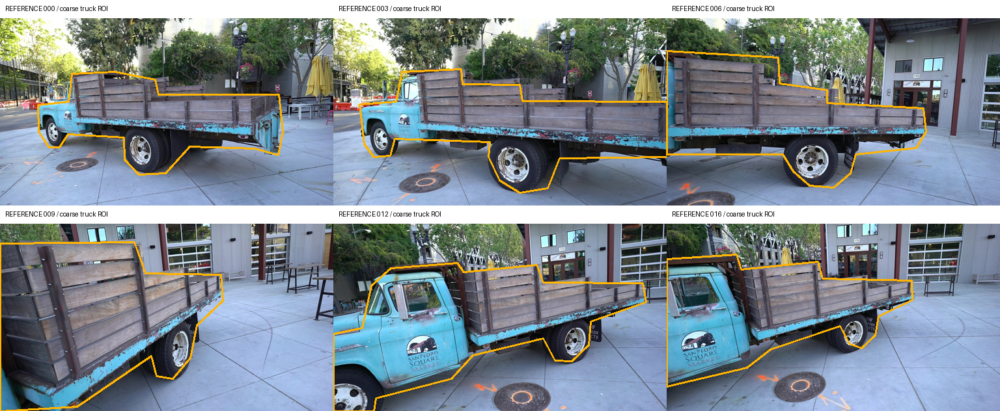
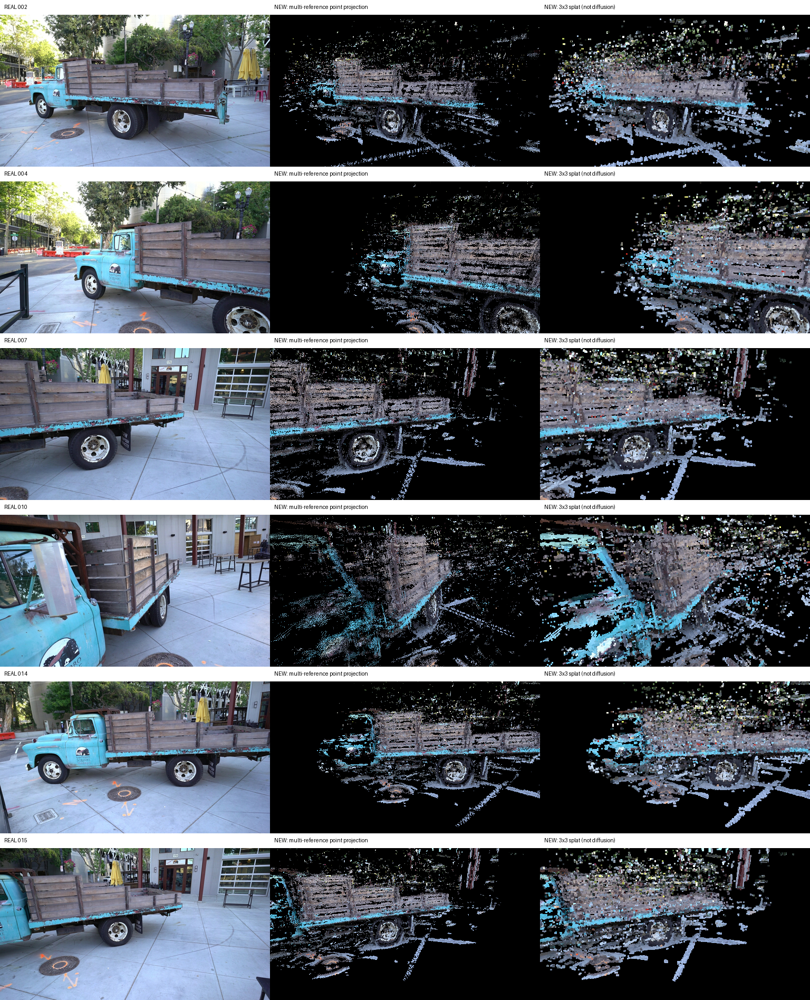
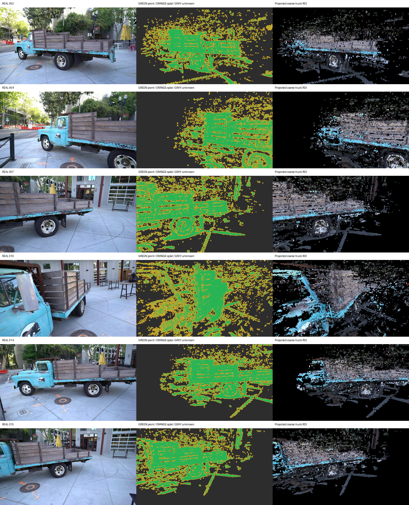
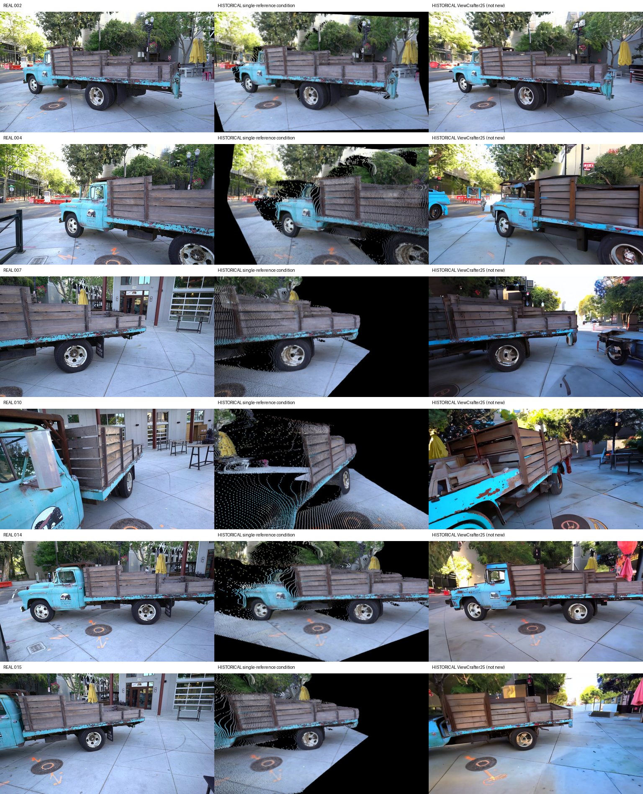

# Truck 单场景证据保持预实验

## 结论

本次实际完成了六张真实参考图的 CPU 多视图几何、任务区域投影、六个评价视角的图像对比及条件数组输出。没有执行新的扩散生成，也没有训练任务证据适配模块。整条研究路线尚未验证。

结果显示：在给定历史估计相机的情况下，参考图可以形成部分车身及车轮附近的外观证据，但覆盖率和几何完整性不足。小范围点扩展改善覆盖，同时产生块状纹理和边界混合；不能把覆盖提高解释为真实信息恢复或目标保持率提升。

## 实际运行条件

- 当前 `nvidia-smi` 返回 `Failed to initialize NVML: Unknown Error`，PyTorch CUDA 不可用。
- 原 `envs/viewcrafter` 环境及 `checkpoints/DUSt3R/model.safetensors` 不存在。ViewCrafter 25 帧权重仍在，但没有完成新一轮推理。
- 本次采用 CPU 替代几何基线：SIFT 匹配、已知相机三角化、80 层逆深度平面扫描、7×7 ZNCC 匹配及跨参考深度一致性过滤。它不是 DUSt3R 的复现，也不是完整研究方法。
- 运行依赖版本记录在 [manifest.json](manifest.json)。正式复跑耗时约 35.2 秒，不含依赖安装、人工检查和报告整理。

## 输入与划分

使用 `truck_stride3` 的帧编号；对应原始文件编号为 `3 × 帧编号 + 1`。读取实际 raw JPEG，绕过迁移后失效的 clips 符号链接。

| 用途 | 帧编号 | 数量 |
|---|---|---|
| 参考图 | 0、3、6、9、12、16 | 6 |
| 开发图 | 1、5、11 | 3 |
| 评价图 | 2、4、7、10、14、15 | 6 |

任务：检测卡车，保持可见车身、车轮及邻近地面结构；不推断未观察细节。

参考图中的卡车多边形由助手根据预览粗略描绘，只是任务区域建议，不是人工精标或像素级真值。未计算检测 mAP、真实实例保持率或分割准确率。投影任务权重未被任何扩散模型消费。



这些帧在计算前固定；参数未依据评价结果调优。开发图仅用于输出诊断，本次没有进行参数搜索。

## 信息使用边界

新点云的匹配、颜色、深度来自六张参考图；评价图像仅在几何完成后读取用于对比。但是，相机来自历史使用全部 25 张照片的 DUSt3R 联合估计，因此这是“给定联合估计相机”的诊断，不是完全隔离目标图信息的重建基准。

历史缓存提供的是估计相机，不是真值相机。所有尺度为相对尺度。相机误差、参考重叠不足和低纹理都会影响当前结果。

## 本次新结果

参考匹配留下 521 个通过正深度和双视角重投影阈值检查的点，用于确定平面扫描深度范围。随后得到 158,134 个通过外观及多视图深度筛选的点样本；同一表面可能有多个样本，该数量不代表独立真实三维点数。

下表的覆盖率是整幅 512×288 图像中被光栅化覆盖的像素比例，不是正确像素比例，也不是卡车保持率。

| 评价帧 | 单像素点投影覆盖率 | 3×3 点扩展覆盖率 | 已覆盖区域 RGB MAE |
|---|---:|---:|---:|
| 002 | 21.8% | 39.0% | 0.166 |
| 004 | 25.0% | 41.8% | 0.159 |
| 007 | 29.5% | 46.9% | 0.152 |
| 010 | 25.9% | 52.7% | 0.203 |
| 014 | 24.3% | 37.6% | 0.161 |
| 015 | 24.8% | 38.6% | 0.162 |
| 平均 | **25.2%** | **42.8%** | **0.167** |

MAE 在 RGB 归一化到 0–1 后计算，仅统计点扩展覆盖的区域，排除了所有未覆盖像素，不能作为整图重建质量指标。任务粗区域内 MAE 约 0.148，同样不是经过真值掩膜核验的对象保持指标。



观察：木制货厢、青色车身带和部分车轮轮廓可以对应，但车头和低纹理地面存在大面积缺失。010 帧误差最高，局部车身和边界错位明显。点扩展使画面更满，同时出现明显块状纹理，不能替代更准确的深度和遮挡处理。

## 观测支持及孔洞



- 绿色：单像素点投影已覆盖。
- 橙色：仅在 3×3 点扩展后覆盖。
- 灰色：仍未覆盖，原因未知。

橙色只表示渲染操作新增的覆盖，不能证明那里原本就属于已观测连续表面。灰色可能来自未观测、低纹理、匹配失败或过滤，也不能直接标为“从未观察”。本次尚未实现可靠的孔洞成因分类。

支持计数表示其他参考深度图在相同投影位置满足 3% 相对深度一致性的数量，包含来源参考本身。它是代理量，不能视为校准概率。粗任务区域来自参考多边形；未确认跨视图身份、车轮数量或具体标识文字。

## 历史扩散结果，仅供诊断



此图左列为真实目标照片，中列为历史单参考渲染，右列为历史 ViewCrafter25 输出。右列不是本次生成，也没有使用本次六参考点云和任务条件，不构成新方法与基线的公平比较。

历史结果说明扩散能补出完整画面，但在部分视角改变了背景、木板结构、车轮外观或引入额外车辆。例如 004 帧左侧出现额外青色车辆，010 帧的车厢与驾驶室关系明显偏离真实照片。这些是视觉检查发现，尚未做独立人工标注统计。

## 已保存产物

- [manifest.json](manifest.json)：任务、划分、粗多边形、源文件摘要、相机来源、程序摘要与实现状态。
- [reference_matching.json](reference_matching.json)：参考图匹配与重投影诊断。
- [reference_cloud.npz](reference_cloud.npz)：新计算点云、颜色、支持计数、来源帧及粗任务区域。
- [reference_depths.npz](reference_depths.npz)：各参考深度与外观匹配有效性。
- `frame_002`、`frame_004`、`frame_007`、`frame_010`、`frame_014`、`frame_015`：真实图、投影图、支持图及条件 NPZ。
- [report.json](report.json)：全部数值结果与限制。
- [运行脚本](../../tools/run_truck_evidence_preflight.py)：可复跑的 CPU 预实验。

条件 NPZ 包含 `rgb`、`depth`、`support_count`、`task_roi`、`task_attention`、`valid_projection`、`raster_added`、`unresolved`。这是诊断接口，不能直接当作现有扩散模型的完整输入格式或训练标注。

复跑命令（需要选择尚不存在的输出目录，以免覆盖）：

```bash
OPENBLAS_NUM_THREADS=4 OMP_NUM_THREADS=8 python tools/run_truck_evidence_preflight.py --output outputs/truck_evidence_preflight_repeat
```

已经检查：源文件摘要与历史对应一致；参考和评价帧无交集；条件数组有限值；未覆盖区域任务权重为零；相机后方点不会参与光栅化；脚本可编译。首次运行的中间输出保存在同级 `_initial` 目录；修正了相机后方点取整的警告后，正式复跑得到相同覆盖率和误差。

## 下一步

优先恢复 GPU 与 ViewCrafter/DUSt3R 环境，在相同划分下运行标准多参考几何和新的扩散基线，检查是否改善当前车头和边界的缺失。之后再接入任务证据适配模块，与相同生成设置的基线比较。

当前结果支持“数据可以组织成可复查的证据投影实验”，尚不支持“任务证据约束已经有效”或“扩增数据已能提升真实检测能力”。
