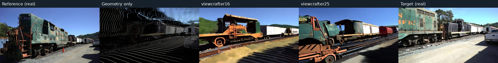
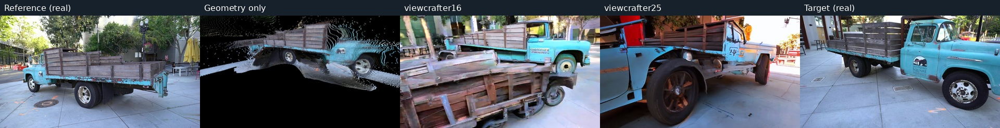

# ViewCrafter：Tanks-and-Temples 有真值子集对比

日期：2026-10-26。状态：4 条真实序列、两个官方模型版本共 8 组生成全部完成，指标已汇总。

## 评测范围

本轮使用 Tanks-and-Temples 的 Train、Truck 两个真实场景，每个场景固定取两条 25 帧序列。生成视角具有真实目标图像，因此可以计算新视角 PSNR、SSIM 和 LPIPS，已经超出前轮只有输入图、没有目标真值的定性试跑。

这是公开数据上的固定子集实验，不是 ViewCrafter 论文完整测试集的复现。在所核查的公开仓库版本和相关 issue 中，没有找到足以重建论文 Easy/Hard 的完整场景、起始帧和采样清单。相关 issue #44 通过私下邮件解决，issue #60 在本轮核查时没有公开答复。我们固定并公开自己的采样规则，不把它命名为论文 Easy/Hard，也不将子集分数与论文表格直接相减作为复现差距。

数据镜像修订、每张图的发布端 SHA256 和具体帧清单见 [dataset_manifest.json](dataset_manifest.json)。选择规则在生成前写入 [评测方案](评测方案.md)：按文件名排序，从第 0 张图开始，以步长 1、3 各取 25 张；没有根据生成质量挑选场景、轨迹或随机种子。

## 相机与生成设置

沿用官方 `single_view_eval` 的方法：DUSt3R 从 25 张真实图估计相机轨迹，随后只用复制的首图重新构建渲染点云。真实目标图参与轨迹估计，但不作为扩散模型的图像条件。这是带目标序列辅助位姿估计的评测，不应描述成整个流程完全不访问目标图。

结果同时受相机估计、单图几何和扩散生成误差影响。本轮没有分离这三部分，不能把全部偏差归因于扩散模型，也没有用额外的尺度或图像配准来针对目标真值调优。

| 序列 | 原始图像采样步长 | 估计的首末相机旋转差 |
|---|---:|---:|
| Train / stride1 | 1 | 13.43° |
| Train / stride3 | 3 | 119.51° |
| Truck / stride1 | 1 | 80.46° |
| Truck / stride3 | 3 | 178.79° |

这些角度来自 DUSt3R 估计的输入轨迹，不是生成图的位姿准确率；旋转差也不包含平移带来的视差。不同场景的相同采样步长不代表相同运动难度。本子集包含超过 100° 的极端视角变化，平均分不能代表通常的 20°–30° 航拍变化。

模型使用官方 ViewCrafter_16 和 ViewCrafter_25 权重，1024×576，50 DDIM 步，seed=123，eta=1，CFG=7.5，guidance rescale=0.7，官方默认提示词。未做训练、微调、挑种子或后处理修图。

16 帧版本从同一条 25 帧几何条件中选取索引 `[0,2,3,5,6,8,10,11,13,14,16,18,19,21,22,24]`。两个版本的主要分数只比较共同的 15 个非源视角，4 条序列合计 60 个目标；它们来自 2 个场景，不是 60 个独立场景。25 帧版本另报告全部 24 个非源视角的辅助结果。

## 指标与对照

- 复制首图：每个目标视角都返回真实源图，检查生成结果是否超过不改变视角的简单基线。
- 仅几何投影：直接使用同一条单图点云渲染结果，保留空洞，检查扩散补全的贡献。
- ViewCrafter_16 与 ViewCrafter_25：官方两个版本在共同目标帧上的直接对照。25 帧版有更多中间条件帧，这是两个版本运行配置的一部分。
- PSNR：RGB [0,1]，逐帧均方误差转换为 dB 后平均；SSIM：RGB 通道平均、高斯窗口 sigma=1.5、总体协方差；LPIPS：官方 v0.1 AlexNet、RGB [-1,1]。源视角不参与新视角均值。
- 同时报告完整 1024×576 画面和居中 576×576 裁剪。未将预测图与真值做事后配准、颜色匹配或掩膜筛除。
- 样本数量小且相互关联，不计算 FID，不报告统计显著性或下游 AP；没有估计生成帧位姿，因此不报告论文的生成位姿误差。

指标版本和权重摘要见 [metric_versions.json](metric_versions.json)。评分实现通过同图 SSIM=1、LPIPS=0，以及恒定像素偏差对应 PSNR=20 dB 的检查。

## 结果

### 相同的 60 个目标视角：完整画面

| 方法 | PSNR ↑，dB | SSIM ↑ | LPIPS-Alex ↓ |
|---|---:|---:|---:|
| 复制源图 | 9.881 | 0.2768 | 0.5975 |
| 仅几何投影 | 8.650 | 0.1735 | 0.7012 |
| ViewCrafter_16 | **11.214** | **0.3299** | 0.5491 |
| ViewCrafter_25 | 10.978 | 0.3286 | **0.5396** |

25 帧版相对复制源图提升 1.097 dB PSNR、0.0517 SSIM，LPIPS 降低 0.0579；相对几何投影提升 2.327 dB、0.1550 SSIM，LPIPS 降低 0.1616。这表明扩散补全在本子集上有用，但并不代表其恢复了真实结构。

25 帧版相对 16 帧版的 PSNR 下降 **0.236 dB**，SSIM 下降 **0.0014**，LPIPS 改善 **0.0095**。没有得到“主版本在本子集上全面更好”的结论；单种子和两个场景也不足以判断这些差异具有统计显著性。

### 相同的 60 个目标视角：中心正方形裁剪

| 方法 | PSNR ↑，dB | SSIM ↑ | LPIPS-Alex ↓ |
|---|---:|---:|---:|
| 复制源图 | 9.883 | 0.2589 | 0.5917 |
| 仅几何投影 | 9.074 | 0.1959 | 0.6595 |
| ViewCrafter_16 | **11.589** | **0.3298** | **0.5253** |
| ViewCrafter_25 | 11.033 | 0.3260 | 0.5272 |

中心裁剪后，25 帧版三项均值都略逊于 16 帧版。完整画面的 LPIPS 小幅改善对裁剪方式不稳健，不能据此笼统称主版本更准确。

### 分序列结果

每格依次为 PSNR / SSIM / LPIPS，均使用共同的 15 个目标视角、完整画面。

| 序列 | ViewCrafter_16 | ViewCrafter_25 |
|---|---|---|
| Train / stride1 | 10.581 / 0.3172 / 0.5426 | 10.555 / 0.3189 / 0.5293 |
| Train / stride3 | 10.160 / 0.3048 / 0.5859 | 9.645 / 0.2959 / 0.5918 |
| Truck / stride1 | 13.034 / 0.3728 / 0.4817 | 13.286 / 0.3844 / 0.4476 |
| Truck / stride3 | 11.080 / 0.3250 / 0.5864 | 10.426 / 0.3150 / 0.5898 |

25 帧版在 Truck / stride1 的三项指标均改善，在两条 stride3 序列上三项均变差；这也说明更长生成序列没有自动解决极端视角下的保真问题。

25 帧版全部 **96 个**非源目标的辅助均值为：完整画面 11.134 dB / 0.3304 / 0.5352；中心裁剪 11.212 dB / 0.3294 / 0.5205。它们与 16 帧版的 60 目标均值不应直接作差；主要版本对比使用前述共同目标集合。

### 直接查看生成与真实目标

下图从左到右为真实输入、仅几何投影、16 帧生成终点、25 帧生成终点、真实目标。



Train 场景中，两个模型都填补了投影空洞，但重绘了机车与车厢的形状、颜色及排列，和目标实拍有明显差异。25 帧版并没有消除这种结构偏差。



Truck 大视角场景中，车身比例、驾驶室、轮胎、木制货厢和背景存在明显重构错误。补出了可辨认的卡车图像，不等于保持了同一辆卡车的结构与标注。

- [Train / stride1 对比视频](train_stride1/comparison.mp4)
- [Train / stride3 对比视频](train_stride3/comparison.mp4)
- [Truck / stride1 对比视频](truck_stride1/comparison.mp4)
- [Truck / stride3 对比视频](truck_stride3/comparison.mp4)

视频依次为真实输入、几何投影、25 帧版生成的共同采样帧、对应真实目标。

## 对任务一的含义

当前流程在这个有真值的子集上超过了两个简单基线，但不足以支持“生成样本可以直接继承目标监督”的结论。首图中可见的实例结构与细节尚不能稳定保持，更不能把新显露区域的推测内容视为真实标签。

下一步应先检查几何条件与真实目标的对齐程度，区分相机/深度误差和扩散重绘误差，并在适中的视角跨度上验证目标保真。只有能够筛出可靠样本，才适合继续检测标注、图文扩增及真实测试集上的下游收益实验。本轮没有进行这些下游训练，也没有据此宣布 ViewCrafter 在其他数据或完整论文协议下失效。

## 论文参考值的使用边界

[论文表 I](https://arxiv.org/html/2409.02048v1#S3.T1) 的 Tanks-and-Temples 主模型结果为：Easy：PSNR 21.26 dB、SSIM 0.655、LPIPS 0.194；Hard：18.07 dB、0.563、0.283。论文为与其他方法对齐，对图像做了正方形裁剪。本轮提供中心正方形分数，但未知精确采样、裁剪及评分实现细节，仍不等于论文相同评测协议。

[论文表 IV](https://arxiv.org/html/2409.02048v1#S4.T4) 的消融实验中，16 帧版为 19.07 dB / 0.610 / 0.289，主版本为 19.52 dB / 0.615 / 0.280。这是作者的版本对照，不是本轮实测值；与本轮相同目标上的版本差异应分别列示。

## 复现与文件

本轮使用前轮已验证的官方提交 `97cdb8634b28708cbd50912d57c52f23c5ffbf09`。兼容层使用 PyTorch SDPA，官方权重严格加载；环境不是作者的旧版 PyTorch 环境，因此不承诺逐像素相同。新增指标依赖固定为 lpips 0.1.4、scikit-image 0.25.2、numpy 1.26.4、tifffile 2024.8.30。完整快照见 [environment.freeze.txt](environment.freeze.txt)。

25 帧权重修订为 `35af104d9781e9ed5cdaddfcfbbdca5835e1c36f`，SHA256 为 `5676e29d8f9d5b6c9bebdaaf6c2fa048c79fd31486937adfb10cc58c918ce422`，与发布端一致，见 [checkpoint25.json](checkpoint25.json)。16 帧权重沿用前轮已核验文件。

本机已有环境与检查点时，在工作区运行：

```bash
bash tools/reproduce_viewcrafter_benchmark.sh outputs/viewcrafter_benchmark_rerun
```

脚本先准备固定数据子集，再执行几何估计、两个模型的生成、指标计算和完整性验证。已有 `run.json` 的阶段可续跑；需要完全重跑时使用新的输出目录。

每个序列目录保存原始生成帧、真实目标帧、几何条件、视频、相机参数、实际配置和耗时。全量逐帧指标见 `metrics_per_frame.csv`，序列均值见 `metrics_summary.csv`，机器可读汇总见 `metrics.json`。

RTX 4090 上，16 帧版扩散阶段平均 77.91 秒、峰值 PyTorch allocated 显存 15.66 GiB；25 帧版平均 122.79 秒、17.38 GiB。模型加载约 35 秒/次，未包含在扩散时间内。详见 [runtime_summary.json](runtime_summary.json)。这些速度与显存不能跨硬件、跨统计口径直接和作者数字作差。

完整性检查记录见 [validation.json](validation.json)：验证输入 SHA256、相同目标的几何条件完全一致、图片尺寸与数量、视频实际解码帧数，以及 60 目标均值的重新计算。初次仅 16 帧的 CPU 评分另存为 `metrics_initial16.json`；本报告使用最终统一 GPU LPIPS 评分的 `metrics.json`，两种设备存在微小数值差异。

协议核查来源：[官方评测入口](https://github.com/Drexubery/ViewCrafter/blob/97cdb8634b28708cbd50912d57c52f23c5ffbf09/run_eval.sh)、[划分问题 #44](https://github.com/Drexubery/ViewCrafter/issues/44)、[划分问题 #60](https://github.com/Drexubery/ViewCrafter/issues/60)。
