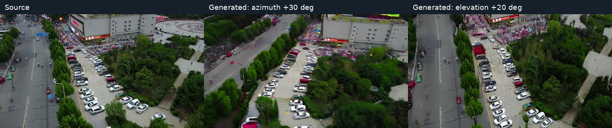
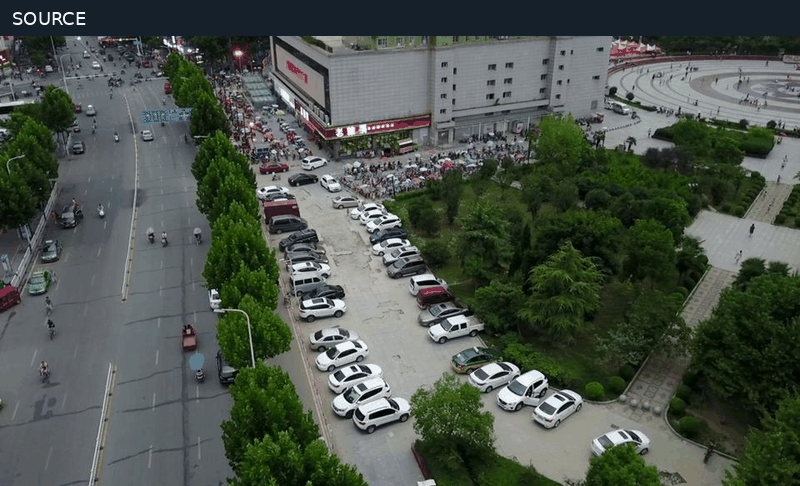
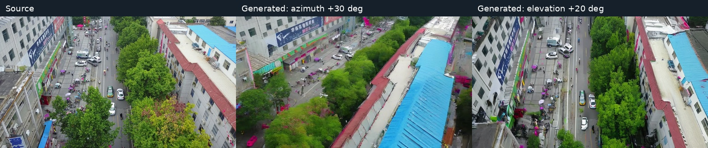

# 明显视角差异与遮挡补全实验：ViewCrafter

日期：2026-10-23。对应《2534054陈阳鑫.pdf》第一研究点的同场景多视角扩增环节。

## 1. 结果与结论

**已完成 2 个真实航拍场景 × 2 种观察方向变化，共 4 组扩散生成实验，另完成 1 组官方样例。** 每组输出 16 帧、1024×576，保存几何条件、实际生成帧、视频和相机参数。

本轮使用 [ViewCrafter](https://github.com/Drexubery/ViewCrafter)（TPAMI 2025），采用公开的 16 帧权重。它以粗点云渲染作为条件，通过视频扩散补全新视角画面，路线与报告第一点更接近。

这次可以清楚观察到道路方向、停车布局投影、屋顶可见比例、前后景位置和遮挡关系的变化。与此同时，部分小车辆轮廓融合或被重绘，建筑细纹理和高对比区域出现伪影。**“观察方向变化明显”已经得到定性验证；“生成样本提供可靠目标监督、能提升下游性能”尚未得到验证。**

模型采用官方消融版本 ViewCrafter_16，不是 25 帧主版本；本轮结果不代表论文最佳配置的完整复现。

## 2. 实验设置

输入沿用前轮公开 VisDrone 图像，来源和 SHA256 见 `../open_source_trials_20261023/input_manifest.json`。每个场景只输入一张照片，不提供目标新视角照片。

| 实验目录 | 场景 | 相机条件 | 扩散生成耗时 | 峰值 PyTorch allocated 显存 |
|---|---|---|---:|---:|
| `parking_phi30` | 停车场 | 横向方位角 +30° | 77.94 秒 | 15.66 GiB |
| `parking_theta_minus20` | 停车场 | 向更俯视方向增加约 20° | 77.95 秒 | 15.66 GiB |
| `buildings_phi30` | 楼宇道路 | 横向方位角 +30° | 77.98 秒 | 15.66 GiB |
| `buildings_theta_minus20` | 楼宇道路 | 向更俯视方向增加约 20° | 78.02 秒 | 15.66 GiB |

硬件为 RTX 4090 24GB。航拍几何阶段约 15.6–15.9 秒/组；扩散模型加载约 35 秒/进程，未计入表中的生成时间。生成时间包含条件编码、50 步 DDIM 和图像解码，不包含随后图片/视频落盘。每个实验独立进程运行，故没有共享模型加载成本。

源图仰俯角统一粗设为 35°，无真实相机标定。沿用官方球面轨迹：以源图中心像素对应的预测三维点为中心，半径为其预测深度；保持半径不变，不额外设置平移或缩放。官方参数 `d_theta=-20` 对应相机向上移动、观察更俯视。

由记录的相机矩阵计算，横向轨迹端点旋转约 30°，俯仰轨迹约 20°；相机基线分别约为球半径的 0.424 和 0.347。数值来自模型估计的场景坐标，不是实际无人机飞行米数。这些矩阵说明施加了什么几何条件，不能证明扩散模型精确实现了同样的真实相机位姿。

所有实验采用 seed=123、16 帧、DDIM 50 步、CFG=7.5、eta=1。视频以 8 fps 编码为 2 秒。没有多种子统计或人工目标重标注。

## 3. 直接查看视角差异

### 停车场

依次为原图、横向 +30° 生成终点、向更俯视方向 +20° 生成终点：



为了避免整幅缩略图不易比较，提供原图与生成终点交替显示的动画：



- [横向变化：原图—几何条件—生成结果视频](parking_phi30/comparison.mp4)
- [俯仰变化：原图—几何条件—生成结果视频](parking_theta_minus20/comparison.mp4)
- [横向终点三列静态对比](parking_phi30/endpoint_comparison.jpg)
- [俯仰终点三列静态对比](parking_theta_minus20/endpoint_comparison.jpg)

观察：横向变化使道路与停车通道的投影方向明显改变，树木和车辆的遮挡布局发生变化；俯仰变化使车辆屋顶、地面与建筑立面的可见比例改变。扩散填补了几何条件中的黑洞，但部分白色车辆的边缘和间隔被改写，远处小目标与高对比区域出现异常色块。新显露区域没有真实对应照片，不能把填入的细节认定为原场景事实。

### 楼宇道路



- [横向变化对比视频](buildings_phi30/comparison.mp4)
- [俯仰变化对比视频](buildings_theta_minus20/comparison.mp4)
- [原图与俯仰终点切换动画](buildings_theta_minus20/source_vs_endpoint.gif)
- [横向终点三列静态对比](buildings_phi30/endpoint_comparison.jpg)

观察：横向变化使右侧屋顶和街道的透视关系明显改变；俯仰变化呈现更接近俯视的街道布局，屋顶与地面可见区域变化。主体楼宇、道路和树木布局仍有可辨认对应，但窗格、屋顶细节、树冠边缘及道路小目标存在重绘、拉伸和局部颜色伪影。没有进行车辆身份或逐对象保真统计。

### 官方样例

[官方人物场景对比视频](official_phi30/comparison.mp4) 用于确认完整推理流程工作正常。它是风格化图像，不是航拍数据，不计入四组航拍效果或性能均值。

## 4. 如何对应任务一

本轮完成了“单图粗几何 → 明显方向变化的轨迹 → 几何条件渲染 → 视频扩散补全 → 视角与伪影检查”的实验链条。它能够作为报告第一点的生成模块试验。

还需区分三个层次：

1. **有明确相机条件**：已经记录横向/俯仰轨迹和矩阵。
2. **图像有明显视角响应**：通过本轮图片与视频定性观察得到支持。
3. **样本能提供有效训练监督**：尚需逐对象确认类别、位置、可见性与身份；本轮发现的失真说明不能直接继承原图框和文本。

本轮没有执行报告中基于可见性、投影尺度、覆盖度的候选排序，也没有训练可靠性或效用预测器。没有真实新视角真值，因此不报告目标视角 PSNR/SSIM 或相机精度；没有检测训练，因此不报告 AP 提升。

生成第 0 帧的 MAE 只用于检查源视角重建，并保存在 `run.json`；它不能度量新视角是否真实。生成第 0 帧保留模型实际输出，没有用原图覆盖。

## 5. 下一步实验应如何收敛

建议把 ViewCrafter 固定为主生成器，先在 10°、20°、30° 的候选轨迹上建立小规模目标可靠性审查，再评价报告中的几何选择准则。横向和俯仰分别比较，防止方向因素混在一起。

每个候选分别记录“观察方向/遮挡是否产生有效变化”和“目标是否仍可可靠标注”。可靠但高度重复的样本，与变化明显但对象被破坏的样本，不能计为同一类成功。还应检查新视角带来的收益是否超过普通二维几何扩增。

本轮每条视频也保存了中间帧，可快速观察失真随运动推进的变化；这些帧是同一次联合生成结果，不能冒充独立的 10°/20° 终点实验或独立随机样本。

先确认能筛出可靠样本，再投入图文标注、效用学习和真实测试集上的下游训练。WAVE 等一致性方法可作为后续候选，但本轮未运行，不能写入实测排名。

## 6. 文件、复现与验证

运行参数和原始指标见各目录 `run.json`、`cameras.json`；汇总见 [summary.json](summary.json)。代码版本、权重校验、环境适配和复现命令见 [方法选择与复现说明](方法选择与复现说明.md)。

本机重跑四组航拍实验：

```bash
cd /root/DroneVisCrt
bash tools/reproduce_wide_view_trials.sh all outputs/wide_view_trials_rerun
envs/viewcrafter/bin/python tools/summarize_wide_view_trials.py \
  --root outputs/wide_view_trials_rerun
```

汇总脚本检查每组条件帧和生成帧各 16 张，并实际解码条件视频、生成视频和三列对比视频，核对各为 16 帧。原始浮点生成像素在写入前检查为有限值。源代码兼容适配的小张量数值检查、Python 与 Shell 语法检查及 `git diff --check` 已执行。

原 PDF 与前轮近视角结果保留。此次文件独立存放，没有创建 Git 提交。
