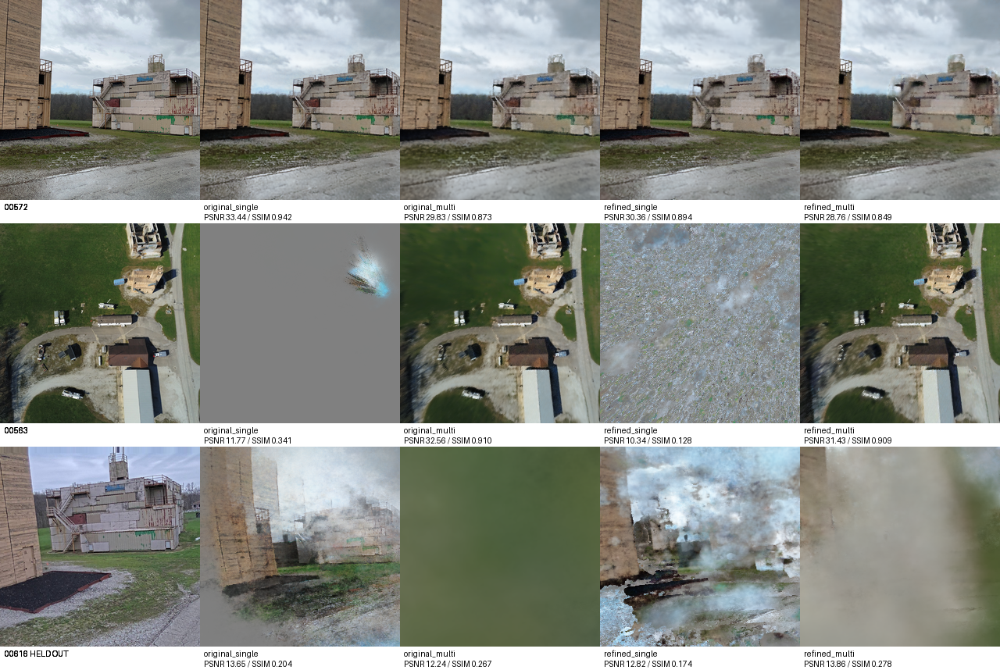

# 单图／双图 NeRF 几何细化实验（2026-11-09）

本实验尝试改善已蒸馏 ZeroNVS NeRF 在第三张地面照片 `00616` 对应相机下的渲染。恢复原正式检查点后，在同一 RTX 4090 上复测原模型，再对单图、双图各追加相同预算的几何细化。原训练脚本、检查点归档及正式输出均保留。

结论：强表面约束加 2000 步细化后，双图的开发检查 PSNR/SSIM 达到 **13.8618 dB / 0.27784**，超过原双图的 **12.2421 dB / 0.26738** 和原单图的 **13.6475 dB / 0.20385**。但图中建筑仍被大片模糊区域遮挡，**数值改善不等于视觉质量可用，也没有证明双图在其他场景或视角上必然更好**。与原单图的 PSNR 差仅 0.2142 dB，无统计显著性结论，不应据此替换正式基线。

## 原实现的不足与改动

原 `run_multiview_experiment.py` 用置信度大于 3 的 MASt3R 预测深度监督条件平均深度 `depth / opacity`。这无法唯一约束表面：等量密度位于距离 1 和 3 的位置，其平均深度也可以等于正确表面的距离 2。训练 RGB 可拟合，但换视角后错误密度可能造成遮挡。该歧义由单元测试直接覆盖；它是实现的不足，不代表已查明本场景全部误差来源。

新增 `surface_constraints.py`，保留 RGB 和平均深度监督，并增加：

- 表面约束：提高预测表面附近的射线终止概率；容许宽度为 `0.08 * range + 0.02`。
- 空区域约束：抑制预测表面前方超过两倍容许宽度的累积终止概率。
- 非有限、低置信度和采样范围外的预测深度不参与几何监督。

这仍使用估计深度，不能纠正错误标定或保证真实几何。过强约束会降低输入图拟合质量，不能只展示有利的新视角指标。

新脚本 `refine_multiview_geometry.py` 从每组自己的 2000 步正式检查点开始，重建 Adam 优化器，学习率 0.001。每组每步总计 2048 条 RGB 射线、每条 96 个区间；双图每张 1024 条，单图 2048 条。RGB 权重 1500、平均深度权重 20，种子 0。细化不再调用扩散教师，不包含新的 SDS 更新。

## 数据与结论边界

- 单图细化只读取 `00572` 的 RGB、预测深度和置信度；双图只读取 `00572`、`00563`。
- `00616` 的 RGB、预测深度和置信度不进入细化损失。其图像只用于最终渲染评分。
- 共享相机估计原本使用过全部三张图，且本轮反复检查过 `00616` 的结果，因此该图明确作为**开发检查**，不能再声称是独立测试。
- 首轮固定 600 步结束后，观察到单图也退化，因此追加了预先固定的三个配置，分别比较约束强度和训练长度。所有尝试均列出，没有按第三张图的分数提前停止训练。
- 仅一个场景、一个细化种子；没有执行同预算的无新增约束消融。因此不能把所有变化归因于新损失，去除 SDS、追加优化及其交互也可能影响结果。

## 全部开发结果

表中均为 `00616` 整张 256×256 RGB 的 PSNR/SSIM，评分实现沿用原实验；原模型也在当前机器重新渲染评分。

| 配置 | 追加步数／每组 | 表面／空区域权重 | 单图 PSNR / SSIM | 双图 PSNR / SSIM |
|---|---:|---:|---:|---:|
| 原正式检查点 | 0 | — | 13.6475 / 0.20385 | 12.2421 / 0.26738 |
| `surface_refinement.json` | 600 | 20 / 20 | 12.7253 / 0.17559 | 13.5215 / 0.28020 |
| `surface_refinement_weak.json` | 600 | 2 / 2 | 13.4630 / 0.19513 | 12.5832 / 0.26898 |
| `surface_refinement_free_space.json` | 600 | 2 / 20 | 13.1759 / 0.19737 | 12.3313 / 0.26559 |
| `surface_refinement_long.json` | 2000 | 20 / 20 | 12.8197 / 0.17364 | 13.8618 / 0.27784 |

2000 步细化组的双图比同预算细化单图高 1.0421 dB，但细化单图比原单图差，因此必须同时报告未细化单图。弱约束和仅增强空区域约束未实现双图 PSNR 超过同配置单图。没有一组得到清晰、几何可信的第三视角。

2000 步细化组的训练视角结果也存在退化：

| 输入视角 | 原双图 PSNR / SSIM | 细化双图 PSNR / SSIM |
|---|---:|---:|
| `00572` 地面 | 29.8288 / 0.87297 | 28.7553 / 0.84925 |
| `00563` 俯视 | 32.5591 / 0.91007 | 31.4314 / 0.90861 |

完整对照图的列依次为真实照片、原单图、原双图、细化单图、细化双图。不能将最后一列颜色更接近真实图解释为恢复了建筑结构。



每个 `outputs/surface_refinement*_20261109/` 保存 `protocol.json`、`results.json`、逐步训练日志、两组状态、重新加载后的各相机图像和对照图；`single/last.pt`、`multi/last.pt` 为本地新检查点，按现有规则不入 Git。协议记录配置、原相机文件及脚本 SHA256，状态记录各自原检查点 SHA256、训练时间和峰值显存。

## 恢复与复现

在仓库根目录执行，选择已安装 CUDA PyTorch、NumPy、Pillow、imageio、imageio-ffmpeg、roma 的 Python 环境。本次创建了隔离的 `sample_augmentation/.venv-refine`，复用系统 PyTorch 2.5.1+cu124，GPU 为 RTX 4090 24GB。

```bash
python sample_augmentation/scripts/restore_multiview_checkpoints.py --workers 16
python sample_augmentation/scripts/refine_multiview_geometry.py --source sample_augmentation/checkpoint_downloads/restored/outputs/multiview_a10 --config sample_augmentation/configs/surface_refinement_long.json --output sample_augmentation/outputs/surface_refinement_retest
python -m unittest discover -s tests -p test_surface_constraints.py -v
```

下载脚本通过已认证 GitHub CLI 下载三份正式对照归档，按仓库 `CHECKPOINTS_MANIFEST.json` 核验 ZIP 及解压文件的大小和 SHA256，只恢复到独立 `checkpoint_downloads/restored` 目录；不会覆盖原正式实验目录。实验脚本要求新的输出目录，避免覆盖已归档结果。Windows 使用对应环境的 `python.exe`；实际解释器与 CUDA 可用性应先确认。

已完成验证：三份归档及其内部文件校验；原模型严格加载并在本机复现接近原记录的分数；三个损失单元测试通过；小规模 CUDA 前向／反传有限性测试通过；四组单双图训练完成并重新加载检查点评分。

后续应优先检查相机和预测几何、可见性冲突及参考视角覆盖，并用新的真实视角或场景做独立评价。当前结果只支持局部数值改进，不能作为高质量扩增已完成的证据。
