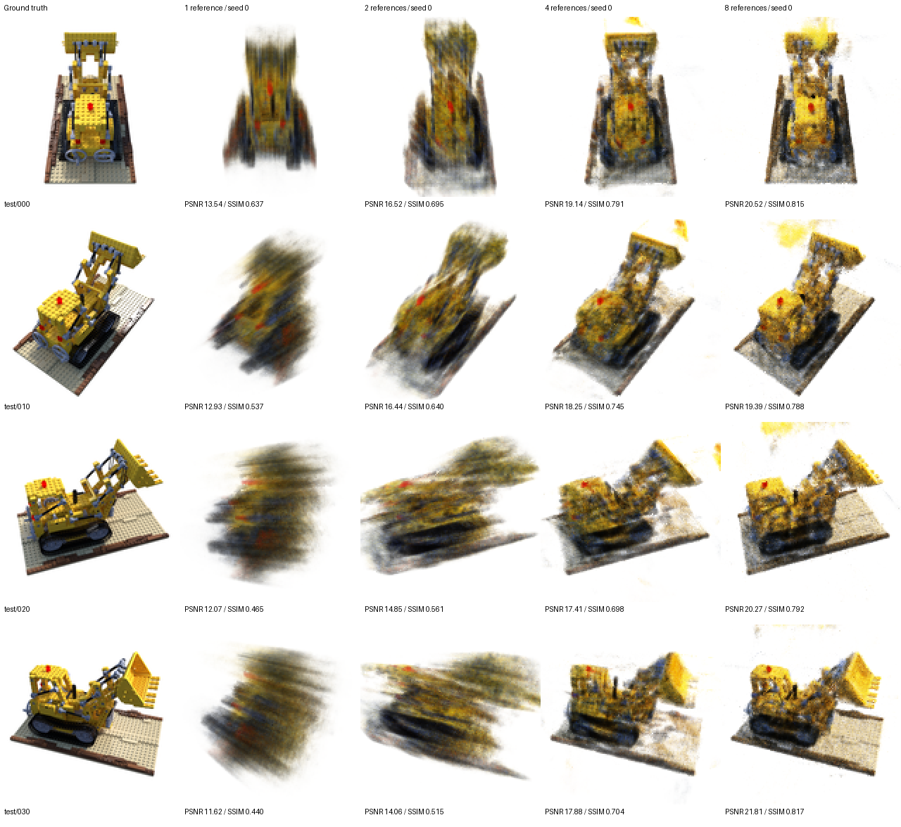
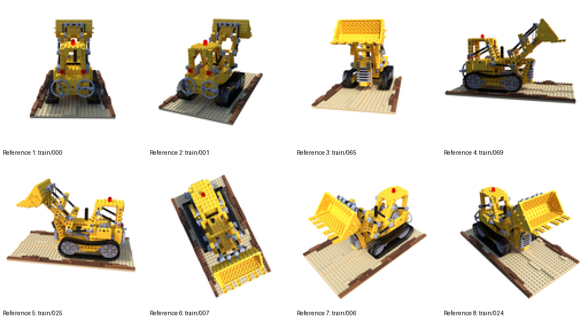
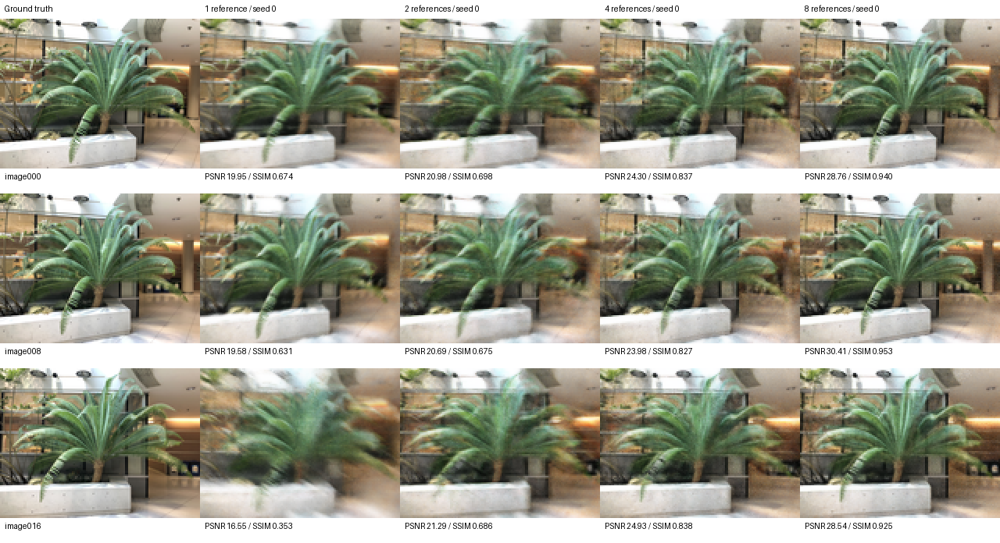
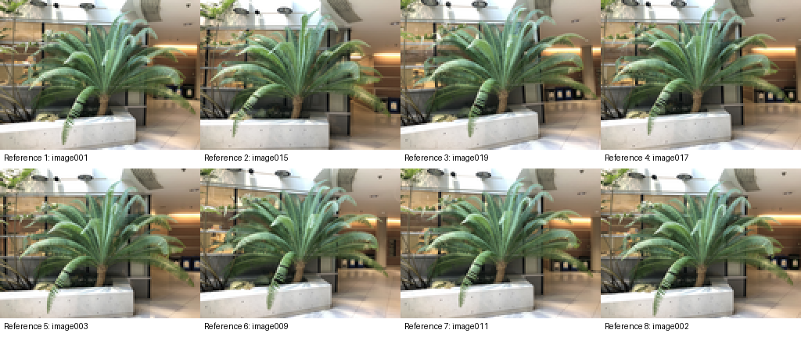

# Lego → LLFF Fern 稀疏视角 NeRF 诊断结果

本实验复用现有 PyTorch 哈希网格 NeRF，排查输入视角数与射线采样。没有使用 ZeroNVS 教师、SDS、预测深度或新增表面约束；因此不能据此宣称 ZeroNVS 本身已经改进。

## 固定协议

每组 1500 步，每步 1024 条射线、每条 64 次场查询，哈希表 log2_size=17。学习率从 0.005 指数衰减到 0.0005。三种子主实验采用 32+32 分层重要性采样；均匀 64 点采样只做种子 0 的单/双图消融。单/双/四/八图使用嵌套参考集合、相同总射线预算、固定最终步；输入增加时单张图的射线份额减少。

Lego 使用准确渲染相机，128×128，白底合成；官方 train 提供训练候选，val 每 10 张取 1 张共 10 张开发图，test 每 10 张取 1 张共 20 张测试图。另报告 alpha≥0.5 的前景 PSNR，alpha 不进入训练损失。

Fern 使用官方 SfM 相机，128×96。按排序索引模 8：0 为测试、4 为开发、其余训练，共 15 张训练候选、2 张开发图、3 张测试图。归一化和近远边界由训练候选相机元数据确定。SfM 上游使用了场景多图，不能称为单/双图独立标定。

两场景及实验矩阵在训练前写入 study.json/scene.json；仅完成全部 14 组后开放最终测试，并保存 test_seal.json 及模型摘要。没有依测试表现选图、选种子或挑检查点。前四个固定测试视角用于图示，未按效果挑选。

## lego

原始图像数：400；第二参考相对旋转：19.69°。

| 采样 | 输入图数 | 种子数 | 测试 PSNR 均值 ± 标准差 | 测试 SSIM 均值 ± 标准差 |
|---|---:|---:|---:|---:|
| hierarchical | 1 | 3 | 12.6506 ± 0.0452 | 0.5392 ± 0.0014 |
| hierarchical | 2 | 3 | 14.4467 ± 0.2150 | 0.5651 ± 0.0050 |
| hierarchical | 4 | 3 | 18.0748 ± 0.1619 | 0.7305 ± 0.0014 |
| hierarchical | 8 | 3 | 22.3605 ± 0.0441 | 0.8427 ± 0.0051 |
| uniform | 1 | 1 | 12.7114（单种子） | 0.5253（单种子） |
| uniform | 2 | 1 | 14.2227（单种子） | 0.5441（单种子） |

双图减单图的逐种子差值：

- seed 0: PSNR +2.0530 dB，SSIM +0.03073。
  逐视角严格提升：PSNR 20/20，SSIM 14/20；平均提升不代表每个视角的所有指标都提升。
- seed 1: PSNR +1.6111 dB，SSIM +0.02647。
  逐视角严格提升：PSNR 20/20，SSIM 13/20；平均提升不代表每个视角的所有指标都提升。
- seed 2: PSNR +1.7242 dB，SSIM +0.02041。
  逐视角严格提升：PSNR 20/20，SSIM 13/20；平均提升不代表每个视角的所有指标都提升。

14 组累计纯训练用时 347.3 秒；峰值 PyTorch 已分配显存 0.620 GiB。时间不包含下载、数据预处理、开发及测试渲染。

Lego 前景 PSNR（按图计算后对视角及种子等权平均）：

- hierarchical_1: 9.8224 dB。
- hierarchical_2: 12.4086 dB。
- hierarchical_4: 14.7118 dB。
- hierarchical_8: 18.2376 dB。
- uniform_1: 10.0407 dB。
- uniform_2: 12.1605 dB。

参考输入按顺序排列：单图取第 1 张，双图取前 2 张，四图取前 4 张，八图全部使用。

## fern

原始图像数：20；第二参考相对旋转：12.38°。

| 采样 | 输入图数 | 种子数 | 测试 PSNR 均值 ± 标准差 | 测试 SSIM 均值 ± 标准差 |
|---|---:|---:|---:|---:|
| hierarchical | 1 | 3 | 18.8233 ± 0.2304 | 0.5551 ± 0.0140 |
| hierarchical | 2 | 3 | 20.9433 ± 0.1529 | 0.6836 ± 0.0114 |
| hierarchical | 4 | 3 | 24.2615 ± 0.1373 | 0.8289 ± 0.0056 |
| hierarchical | 8 | 3 | 29.0379 ± 0.2014 | 0.9363 ± 0.0029 |
| uniform | 1 | 1 | 18.5922（单种子） | 0.5024（单种子） |
| uniform | 2 | 1 | 20.5382（单种子） | 0.6375（单种子） |

双图减单图的逐种子差值：

- seed 0: PSNR +2.2905 dB，SSIM +0.13383。
  逐视角严格提升：PSNR 3/3，SSIM 3/3；平均提升不代表每个视角的所有指标都提升。
- seed 1: PSNR +1.9819 dB，SSIM +0.12311。
  逐视角严格提升：PSNR 3/3，SSIM 3/3；平均提升不代表每个视角的所有指标都提升。
- seed 2: PSNR +2.0877 dB，SSIM +0.12851。
  逐视角严格提升：PSNR 3/3，SSIM 3/3；平均提升不代表每个视角的所有指标都提升。

14 组累计纯训练用时 353.6 秒；峰值 PyTorch 已分配显存 0.619 GiB。时间不包含下载、数据预处理、开发及测试渲染。

参考输入按顺序排列：单图取第 1 张，双图取前 2 张，四图取前 4 张，八图全部使用。

## 解释边界

上述结果只支持本次场景、输入选择、低分辨率和固定训练预算下的结论。没有复现原始 NeRF 或 ZeroNVS 论文训练设置。Lego 与 Fern 各一个场景，不能据此保证任意场景中双图必优于单图；三种子标准差不是跨场景置信区间。

单图不能唯一确定三维结构；更高训练 PSNR 不代表更高新视角质量。若 4/8 图改善而 2 图仍失败，应将问题定位到稀疏输入、覆盖和先验需求，而非把训练视角拟合当作成功。进一步验证 ZeroNVS 或表面约束需另行冻结教师、深度来源及等预算对照，不能混用本次纯 RGB 基线。
