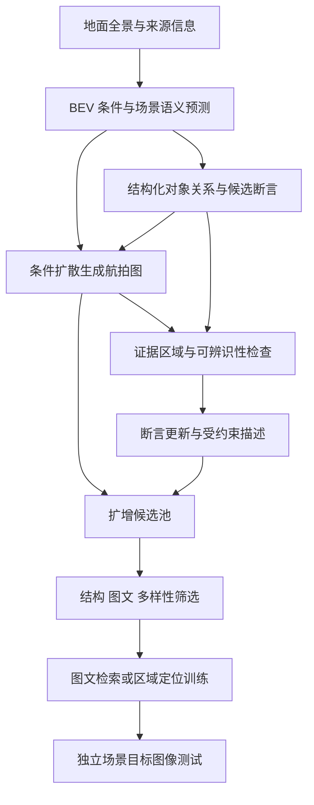

# 无人机巡检视角下的证据约束图文生成与样本扩增：完整实验方案

日期：2026-10-14。按用户已确认的资源设计：现有 SkyDiffusion / G2A-3 数据，单张 RTX 4090。本文是拟开展的研究方案，方法、预算、阈值和目标均未经过实验验证，不代表已有成果或录用保证。

## 1. 建议的研究定位

**建议题目：面向无人机巡检的可辨识性约束跨视角图文生成与可靠样本扩增。**

英文工作题目：Observability-Constrained Ground-to-Aerial Image–Text Generation for Inspection Data Augmentation。

核心问题：跨视角生成会改变目标的外观、大小和遮挡关系，原有文字标签可能失效。如何让生成图像、目标证据和文字断言相互一致，并让扩增数据改善独立测试场景上的识别能力？

论文应围绕一个可检验的机制展开：**文字断言由目标图像中的可辨识证据约束；生成图像又受到同一组结构化语义条件约束。** 这样可以研究为什么扩增有效、什么时候失效，而不只是展示漂亮的航拍图。

“SkyDiffusion + 自动描述模型 + LoRA”可作为基础系统，但本身不足以证明顶级投稿所需的新意。真正需要验证的是：可辨识性约束是否比直接沿用源描述、事后描述生成图像、普通图文匹配过滤更能减少标签错误，并提高下游泛化。

“A级”必须以学校或单位采用的名单为准。研究方向可对应 CVPR、ICCV、ACM Multimedia 等高目标会议；ECCV 也高度匹配，但不能在未核对名单时统一称为A级。期刊可按贡献考虑 TPAMI、IJCV、TIP、TMM 等，其中各刊的机构评级、分区和是否在允许名单内需要分别核对。

## 2. 当前资源能够支持什么

### 2.1 已有事实

| 资源 | 当前项目证据 | 对本方案的作用 |
|---|---|---|
| G2A-3 Disaster | 本地清单记录 2,714 对地面/航拍图；当前仅跑了 8 对流程诊断 | 真实跨视角生成、复杂场景图文理解；灾害细粒度标签需要另行核验 |
| G2A-3 History | 既有报告记录 2,128 对；数据版本与内容仍有待核对 | 时间与地域域偏移、普通场景语义泛化 |
| G2A-3 UAV | 本地外层 ZIP 含 bottom/left/right 对应的六个图像 ZIP | 主实验候选；先核验内部配对关系、独立地点和可用样本数量 |
| UAV 子集来源 | SkyDiffusion 正式论文说明：MatrixCity / UE 渲染，地面全景与同位置 20 米向下相机 | 可用于模拟低空正俯视研究，不能当作真实无人机实拍 |
| 当前模型 | CVACT 标注的公开权重已经能推理；尚未确认各 G2A-3 子集专用权重 | 可作为公开权重迁移起点，须做域内适配和统一基线训练 |
| 当前硬件 | 单张 RTX 4090；项目已验证小批量推理 | 适合冻结主干、LoRA / 小型适配器，避免从头训练大模型 |

数据数量来自当前项目报告，不替代本次完整清点；UAV 内部的 bottom/left/right 文件名不能单独证明已经具备任意位姿或三视图轨迹监督。

### 2.2 三个必须分开的目标

1. **现有数据主线：固定俯视跨视角图文生成。** 输入地面全景，输出对应俯视风格图像、证据区域及文字；相机模式主要由数据集设定固定。
2. **现有数据上的可辨识性研究：** 通过裁剪、分辨率退化、明确记录的遮挡操作，研究可见证据变化时文字如何更新。这些操作不是米制高度变化或真实三维视角变化。
3. **扩展研究：任意无人机位姿控制与真实巡检。** 需要新增带相机内外参的多角度数据，以及真实巡检测试集。仅凭当前 G2A-3 不足以证明这两项能力。

建议先完成 1 和 2 的闭环，再按初步收益决定是否扩展 3。若全文只使用现有数据，论文题目和结论应明确是 G2A-3 上的跨视角图文扩增，不能写成已完成真实无人机缺陷巡检。

## 3. 科学假设与论文贡献

### 3.1 研究假设

- H1：跨视角变化及可辨识性降低，会导致沿用原图描述的图文标签错误；错误随目标变小、遮挡增加和条件错位而增加。
- H2：把每条断言与目标区域、证据置信度和可辨识状态绑定，能够在相同断言覆盖率下提高文字准确率。
- H3：使用上述约束筛选和训练的合成图文数据，比等量无约束合成数据更能提高独立场景上的检索、定位或分割表现。
- H4：扩增收益主要来自可靠语义和有效困难样本，而非训练步数增加、合成数量增加或筛选器偏好。

### 3.2 建议主张的贡献

1. **方法贡献：证据区域与可辨识状态共同约束图文生成。** 给出条件表示、可辨识性学习目标和文字更新规则，而不只是换一个提示词。
2. **训练贡献：利用同场景的可辨识性变化构造反事实图文对。** 让模型学习“存在、可辨识、可断言”的区别，并用验证集校准断言置信度。
3. **证据贡献：建立人工核验的图文与区域基准，证明真实目标图像上的下游收益。** UAV 合成域与 Disaster / History 实景域分别报告，不混合成“真实无人机测试”。

这些是拟议贡献，需要进一步检索 2025–2026 年的相关工作并做差异表。不能仅根据当前几篇论文声称“首个”或“首次”。如果可辨识性约束不优于简单事后描述与过滤，方法主张需要调整。

## 4. 数据构建与划分

### 4.1 优先采用的语义范围

先使用 G2A-3 能够支撑的粗粒度属性：道路、建筑、植被、车辆、水域等的存在性、位置与空间关系；具体类别经过抽样清点后确定。

暂不直接把整个 Disaster 子集标为“损坏建筑”，也不由地面图推断不可见屋顶损坏。灾害、裂缝、腐蚀、泄漏等诊断需要局部可见证据和专门标注；现有数据不支持时不设为主实验类别。

建议下游主任务选为：**无人机俯视图文检索 + 区域文本定位**。若人工区域标注预算不足，先完成检索，区域定位作为扩展。分割可验证结构保持，但需要独立可靠的分割测试标签。

### 4.2 样本格式

每条数据至少记录：

| 字段 | 含义 |
|---|---|
| scene_id / location_group | 地点或场景组，用于划分与防泄漏 |
| source_image / target_image | 地面全景及目标航拍/渲染图 |
| domain / provenance | UAV-rendered、Disaster-real、History-real，以及来源 |
| camera_mode | 数据已知的相机模式；未知数值用 unknown |
| objects | 类别、框或掩膜、属性和置信度 |
| assertions | 每条文字断言的主语、关系、宾语与证据区域 |
| discernibility | 可辨识、不可辨识、不确定三种状态及其标注来源 |
| source_support | 能被地面观测支持、仅目标图可见、无法确定 |
| caption / questions | 描述、区域问答及人工/自动标注状态 |
| augmentation_parent | 原始样本 ID、操作、参数、随机种子 |
| split / audit_status | 划分与人工核验记录 |

训练阶段可以从真实目标图构造监督；推理时不能读取待评估的目标真值、真值区域、真值描述或真值布局。输出报告应保留“由生成图支持”与“由原始观测支持”的区别。

### 4.3 自动初标与人工金标准

1. 使用一个固定视觉语言模型初步提取对象、关系和描述。
2. 使用检测/分割模型提供候选区域，不能把模型输出直接视为真值。
3. 采用固定词表与关系集合，将描述拆成可核查断言。
4. 人工核验验证集与测试集的重点断言；训练集可使用带置信度的伪标签。
5. 自动标注器与最终评估器应尽量分开；至少对关键指标使用人工金标准，并报告训练标签抽检误差。

建议起步人工核验 300–600 个图像对，按 UAV / Disaster / History、目标尺度、遮挡、条件可靠性分层抽样。这是工作量建议，不是已经拥有的标注。每条样本包含数条断言，关键样本由两人独立标注并仲裁分歧。正式样本量根据初测方差和置信区间宽度调整。

### 4.4 场景划分

- 如果作者正式划分可获得，首先保留用于复现比较，并检查相邻地点泄漏。
- 无法取得时，建立自己的按地点分组划分，清楚写明与论文不是同一协议。
- 建议训练/验证/测试按场景约 70/10/20；不是按图像随机拆分。
- 先按坐标、视域、图像重叠与近重复聚类，必要时加入空间缓冲区。具体距离由实际视域与相关性确定。
- 同地点的全部地面图、航拍图、左右分支、裁剪、描述、生成样本必须进入同一集合。
- 生成器、伪标签适配、扩增筛选器与下游模型均只学习训练场景；阈值和混合比例只在验证集选择。

有限标签实验使用 5%、10%、25%、100% 的训练标签预算时，生成器、语义标注器和筛选器使用了哪些额外标签必须单独列明。不能只削减下游模型标签，却让生成器看到完整测试相关监督，然后称为纯少样本结果。

## 5. 方法设计

### 5.1 总体结构

图中目标图真值只进入训练损失与离线评估，不作为生成时输入。

### 5.2 基础生成器：保持单卡可实施

先沿用现有 SkyDiffusion 的全景→Curved-BEV→条件扩散路线，冻结大部分扩散主干，训练 LoRA、条件适配器或小型语义分支。

需要先确认当前实现中哪些参数真正可训练、文本条件是否生效、训练输入归一化与采样参数是否匹配。项目已经指出公开代码缺少完整训练入口，因此“添加训练入口并验证梯度”是实际开发任务，不能当成已有能力。

主要条件包括：

- RGB BEV：提供外观和近似空间组织。
- 预测语义布局：提供道路、建筑等类别区域，不把目标真值布局偷偷输入测试生成器。
- 结构化语义：类别、属性和空间关系，作为小型适配器或文本 token 输入。
- 相机模式：第一阶段固定正俯视；无可靠相机参数时不训练米制高度控制。

先做“只增加域内 LoRA”的基线，再加入语义与可辨识性约束。这样可以区别域适配带来的收益与新方法带来的收益。

### 5.3 核心一：证据约束的结构化图文表示

对每个对象 o 定义：

E_o = (类别, 候选区域, 属性, 关系, 来源支持状态, 可辨识概率, 置信度)。

这里的“可辨识”指目标图中是否有足够信息支持某项具体断言，它不同于对象在世界中是否存在。类别可辨识不自动意味着损坏类型或数量可辨识。

文字输出区分三种状态：

1. **有充分证据：** 可以表述存在、位置和经过验证的属性，例如“图像左侧有建筑”。
2. **证据不足：** 输出“无法从当前图像确认该属性”或省略该断言。
3. **确认不存在：** 只有被检查区域足够可辨识且缺失标注可靠时才能使用；不能因为检测器没检出就写“没有”。

第一阶段从地面图与 BEV 预测候选语义；第二阶段在生成图上检查证据。图文描述可以描述合成画面中确实可见的对象，但如果这些对象不能由输入支持，不能据此宣称它们是同地点真实对象。

对检查发现的语义冲突，允许两种可记录操作：根据图像更新文字，或重新采样图像。报告各自发生比例、平均采样次数与成本，避免用无限重采样掩盖成功率。

### 5.4 核心二：可辨识性变化与反事实图文监督

现有数据只有固定俯视模式时，首先构造**图像可辨识性变化**，而不是声称已有真实跨高度监督。

对同一目标图，产生如下变化：

- 降低有效分辨率后恢复输出尺寸，记录实际退化比例。
- 裁剪使指定目标离开画面，裁剪区域与目标掩膜有明确关系。
- 采用显式掩膜遮挡目标，记录遮挡比例；这类人为遮挡与真实遮挡分开评估。
- 在已标注对象间构造位置、类别、数量的困难负描述。

同一个基础图像与其变体构成一组。例如：

| 变体 | 可核查状态 | 期望文字 |
|---|---|---|
| 清晰图 | 建筑和道路关系可辨识 | “建筑位于道路右侧” |
| 低分辨率图 | 建筑类别仍可辨识，屋顶细节无法辨识 | 保留建筑位置；不输出屋顶缺陷细节 |
| 裁剪图 | 建筑落在画面外 | 描述当前可见道路；不继承原建筑断言 |
| 遮挡图 | 建筑局部信息不足 | 省略不可靠属性或标为无法确认 |

可辨识标签通过人工子集校准。对象像素面积、边缘清晰度、遮挡比例和局部特征是估计量，不能使用一个统一像素阈值当作全部类别的物理真值。

对类别/属性可辨识概率分别学习，并绘制断言精度—覆盖率曲线。不能仅靠大量拒答降低错误率；应在固定覆盖率下比较方法，同时报告信息量和拒答率。

模型可以将证据区域与可辨识 token 作为共享条件送入图像适配器和文字模块。基础版本先固定文字主干，仅训练小型证据选择器；高级版本再研究联合微调，避免单卡资源被大模型双主干训练耗尽。

### 5.5 学习目标

总体目标可写为：

L = L_diffusion + λ_layout L_layout + λ_assert L_assert + λ_disc L_disc + λ_cf L_counterfactual。

| 损失 | 监督信号 | 作用与限制 |
|---|---|---|
| L_diffusion | 训练对中的目标航拍图与标准去噪目标 | 学习跨视角生成与域内外观 |
| L_layout | 训练目标图的语义区域与关系伪标签，金标准用于评估 | 保持粗布局；不能冒充精确三维几何 |
| L_assert | 原子断言及证据区域 | 约束描述内容与区域的一致性 |
| L_disc | 可辨识/不可辨识/不确定标签 | 学习类别和属性级证据可靠性 |
| L_counterfactual | 同图变化前后的断言有效性、困难负描述 | 保留仍成立的断言，删除已失效的断言 |

反事实损失的关键是区分“语义保持”与“语义失效”：只对仍有证据的属性施加一致性，不强迫低分辨率、裁剪和遮挡图保留原图全部描述。

并非所有损失都需要直接反传穿过完整采样过程。起步时采用三阶段训练：扩散适配器 → 证据/可辨识性模块 → 扩增筛选与下游训练。只有在结果支持共享条件有作用时，再增加短程联合训练。

需要明确梯度路径：如果区域检查和文字生成全部在采样后离线进行，就只能声称“图文生成与校验框架”，不能声称已实现图像文本端到端联合优化。若要做联合机制，至少要证明共享语义/可辨识条件进入生成器并产生可测量的控制效果。

## 6. 扩增策略

### 6.1 先扩增可靠语义，再扩增罕见缺陷

对每个训练地面样本，起步生成 2–4 个候选，固定采样预算。变化可以包括随机种子、受约束外观条件和可辨识性变体，但未经验证的天气变化不应默认保持全部标签。

第一轮仅使用道路/建筑等粗粒度语义。细粒度缺陷合成作为第二阶段，需要专门的数据、编辑区域与独立检测核验；不能通过在文本中写“有裂缝”就认为生成出了正确裂缝。

### 6.2 多条件质量筛选

先进行硬性排除，再做覆盖选择：

1. 排除图文互相矛盾、明显结构崩坏、关键对象身份失效的候选。
2. 检查与预测布局的兼容性；布局预测本身也可能出错，因此同时报告真实目标布局评价。
3. 依据可辨识性与断言置信度过滤错误标签。
4. 去除近重复，同时保留不同类别、区域和尺度的覆盖。
5. 加入一部分随机合格样本，避免筛选器只留下容易样本。

所有质量阈值只在验证集确定。报告接受率、被剔除原因、类别分布变化和每个合格样本成本。

筛选器与下游模型高度相似时，可能出现对同类模型有效、对其他模型无效的偏好。至少使用两个不同下游模型，或一个模型加人工评估，检查收益是否能迁移。

### 6.3 下游训练

比较真实/原始目标训练数据与生成数据的比例：1:0、1:0.5、1:1、1:2。这里 UAV 子集的原始目标本身是渲染图，表格中应使用“原始数据”而非一律称“真实数据”。

可用合成样本质量权重进行混合训练，但必须与不加权、随机选择、简单 CLIP 过滤作对照。硬负样本只进入相应对比学习任务，不能把错误描述当成正标签。

训练预算做两种比较：固定训练步数的主比较，以及固定总计算量的成本比较。不要将扩大数据集后增加训练时长的效果归因于方法。

## 7. 完整实验矩阵

### 7.1 基线

| 组别 | 方法 | 要回答的问题 |
|---|---|---|
| B0 | 原始数据 + 常规图像增强 | 没有生成扩增时的下游基线 |
| B1 | SkyDiffusion 公开权重直接迁移 | 未做域适配的起点，仅作参考 |
| B2 | SkyDiffusion + 同训练集域内 LoRA | 收益是否只是域适配 |
| B3 | 同骨干条件扩散 / ControlNet + 布局和普通文本 | 普通语义条件是否已足够 |
| B4 | B2 生成图 + 直接继承源图文字 | 视角改变引入多少标签噪声 |
| B5 | B2 生成图 + 事后自动描述 | 最直接可实施的图文扩增基线 |
| B6 | B5 + CLIP 或一般图文一致性过滤 | 是否只是一般质量过滤的收益 |
| B7 | B5 + 人工/高质量证据筛选的小规模参考 | 检查自动模块离理想质量还有多远 |
| Ours | 共享证据条件 + 可辨识性 + 反事实监督 + 扩增 | 完整方法是否有必要 |

GPG2A 是重要的跨视角布局/文字基线；能复现时加入。如果不能完整复现，要列明缺失条件，不把引用论文数字混入本地统一排名。新视角模型和 3DGS 只有在输入观测、位姿与数据条件适配时才加入，不能作为天然公平的同条件对照。

### 7.2 核心实验

| 实验 | 设置 | 主要读数 |
|---|---|---|
| E1 生成与布局 | UAV / Disaster 分开训练或明确统一训练；相同训练与输出配置 | LPIPS、KID / FID、结构 IoU、关系准确率 |
| E2 图文事实性 | 人工金标准；粗类别与细属性分开 | 断言精度、召回、区域定位、拒答率 |
| E3 可辨识性变化 | 清晰→低分辨率→裁剪→遮挡，按操作类型分别报告 | 固定覆盖率的错误率、置信度校准、错误随难度变化 |
| E4 扩增收益 | 5%、10%、25%、100% 标签预算；同训练步数 | 检索 R@1 / R@5，区域定位 IoU@阈值，适用时 mIoU / mAP |
| E5 跨场景与域泛化 | 地域留出；UAV-rendered→实景目标域，类别相容时比较 | 域内/域外性能及下降幅度 |
| E6 资源效率 | 同一 4090，记录训练、候选采样、过滤与下游成本 | 峰值显存、小时数、秒/候选、秒/合格样本 |

Disaster / History 的目标图来自实景航拍/卫星来源，不能直接称为真实低空无人机测试。History 的时间信息需要核对；没有明确时间标签时不声称时序预测。

### 7.3 消融

- 仅域内 LoRA。
- 增加结构化对象/关系条件。
- 增加可辨识性分支，但没有反事实监督。
- 增加反事实监督，但始终继承原文字。
- 仅根据图像事后更新文字。
- 完整共享条件与文字更新。
- 随机筛选、一般图文过滤、完整筛选。
- 固定相同候选数、固定相同接受数的两组筛选比较。

初筛使用单种子。只对主要基线与完整方法运行至少 3 个训练种子；不强求所有组合都跑三遍。仍需记录采样种子，避免逐图人工挑选。

### 7.4 指标与统计注意点

- PSNR / SSIM / LPIPS 用于对齐图像对；前两者不能独立衡量合理但不唯一的生成补全。
- 样本有限时优先报告 KID 及其不确定性；FID 如使用，应统一实现、样本数、预处理和抽样协议，不能在十几张图片上解释成可靠分布指标。
- 图文评价用断言级人工真值。CLIPScore 和同一视觉语言模型自评只作辅助，不证明事实正确。
- 比较断言准确率时固定覆盖率，否则大量省略信息也会得到高精度。
- 检查语义布局保持与未观测区域生成的差异；没有可靠可见性真值时，不将近似 BEV 投影区域写成精确“已观测区域”。
- 置信区间按独立场景组 bootstrap，避免把同地点多个裁剪视为独立样本。
- 使用相同划分、数据和调参预算；报告平均值、离散程度、失败率与不筛选的原始结果。

## 8. RTX 4090 实施方案

### 8.1 工程配置建议

| 项目 | 起步建议 |
|---|---|
| 分辨率 | 调试 256；主要结果 512，与已有生成链路衔接 |
| 生成器 | 现有 SD 1.x / SkyDiffusion 骨干，冻结大部分主干 |
| 可训练部分 | LoRA、小型语义/证据适配器；逐项确认训练内存 |
| LoRA rank | 4 / 8 / 16 中选少量候选，先从 8 起步 |
| 精度 | 优先 BF16，遇到不支持算子再使用 FP16；验证稳定性 |
| batch | 1–2 起步，梯度累积 8–16；实测决定 |
| 内存策略 | 梯度检查点、可用的高效注意力；缓存冻结分支特征 |
| 自动标注 | 3B–7B 级视觉语言模型离线运行，必要时量化 |
| 调度 | 自动标注、扩散训练、生成过滤、下游训练分阶段运行 |
| 初测训练 | 先尝试 1k–2k steps 流程验证，再按验证趋势扩展至 5k–15k steps |

以上为拟定超参数；LoRA 不保证自动省下全部激活显存。当前项目的 FP32 小批量推理显存与速度不能外推为训练预算。

### 8.2 控制实验规模

第一轮：200–500 个训练对，3 个关键基线，500–1,000 个候选扩增样本，用于检查生成内容、文字标签与训练链路。

第二轮：采用完整训练划分，4–8 组方法/消融，每个地面样本生成 2–4 个候选；只对表现有价值的组继续做下游训练。

第三轮：对主要基线和完整方法做多种子、域泛化和人工核验。保留全部生成日志，失败样本不删除。

不预先承诺总训练天数。先实测每步耗时、候选采样耗时和通过率：

T_total ≈ Σ(训练步数 × 秒/步) + 候选数量 × 秒/候选 + 标注过滤时间 + 下游训练时间。

当前报告约 6.83 秒/张仅对应之前 8 对 Disaster 的特定 FP32 推理配置，不能直接作为新训练或批量生成的保证。

## 9. 12 周推进与停止条件

| 阶段 | 建议时间 | 交付物 | 是否继续的依据 |
|---|---|---|---|
| 数据与问题清点 | 第 1–2 周 | UAV 内部清单、地点划分、类别词表、人工核验样例 | 配对可用，存在可评价的目标语义 |
| 可运行基线 | 第 3–4 周 | 域内 LoRA、事后描述、统一评估与成本记录 | 生成比当前直接迁移更有内容关联 |
| 核心机制 | 第 5–6 周 | 证据/可辨识模块、变化数据与共享条件 | 在相同覆盖率下比普通过滤更准确 |
| 扩增验证 | 第 7–8 周 | 有限标签实验、相同预算比较 | 在独立场景上有稳定收益 |
| 泛化与可信评估 | 第 9–10 周 | 多种子、人工评估、失败案例、域偏移 | 收益不依赖单一评估器或单种子 |
| 论文与补充材料 | 第 11–12 周 | 方法图、主表、消融、复现材料、局限 | 核心贡献与证据一致 |

时间安排是研究排期，不是算力或录用承诺；人工标注和基础代码补齐可能需要额外时间。

停止或转向信号：

- 两轮合理域内调优后，生成布局仍无法满足粗语义要求：先缩小场景范围或提升配对质量，不扩充大量错误图文。
- 完整方法不优于“事后描述 + 普通过滤”：不能将复杂管线包装成新机制；分析错误类型后调整目标。
- 图文指标改善，但下游无收益：应研究合成偏差或标签质量，而不是继续堆样本数量。
- 收益只出现在 UAV 渲染域：论文收敛为模拟域数据生成，或补真实测试集再主张巡检泛化。

## 10. 提升到高目标投稿所需的补充

### 10.1 任意位姿版本

如果目标确实是“给定高度、俯仰、朝向生成无人机图像”，建议复用 MatrixCity / UE 的可渲染场景，新增相机采样，导出内外参、深度、语义和遮挡关系。

高度可从 10、20、40、60 米等少量候选起步；俯仰角可以覆盖斜视与俯视，但必须先定义相机坐标和角度约定。训练/测试仍按场景隔离，再加入未见高度、未见角度与二者组合的评估。

条件表示改为相机内外参及像素射线编码，结合目标视角语义/深度投影，而不只在文本中写“20 米”。只在具有可靠几何时使用深度重投影、多视图一致性和实际位姿误差。

此时真正的跨视角反事实可以做到：场景对象状态相同，相机改变，可見区域与断言跟着变化。用模拟器的真实遮挡关系提供监督，比图像裁剪代理更能支撑“视角可观测性”的方法主张。

增加渲染数据本身不是创新。投稿贡献仍应落在共享证据机制、可辨识性学习与跨域下游验证。

### 10.2 真实巡检版本

选一个明确任务，而不是同时做河道、电力和道路全部缺陷：例如道路目标/障碍，或河道漂浮物。获取独立地点的真实无人机图像与人工标注，最好有高度、角度或目标尺度信息。

该测试集不能进入生成器训练、伪标签调优或扩增筛选阈值选择。首先检验粗语义与图文检索，再验证缺陷检测；如果单卡预算有限，用预训练下游模型的小规模适配即可。

不要求一开始采集庞大数据，但必须覆盖多个独立地点与困难条件。采集规模由任务方差和标注成本决定，不能把几百张相邻帧当成几百个独立场景。

在没有真实测试集时，可以完成方法研究与模拟实验，但“提高真实巡检能力”的结论应留待验证。

## 11. 投稿时的组织建议

### 11.1 论文主线

引言用一个可测量的失败实例提出问题：目标在变换后变得不可辨识，原文字仍然断言有目标或有缺陷，导致扩增标签错误。

方法围绕共享证据表示与断言有效性训练展开。实验依次证明：错误确实存在 → 方法减少错误 → 同等数据/训练预算下扩增有收益 → 收益能跨场景或跨域 → 失败模式可以解释。

### 11.2 主表与关键图

- 表 1：图像质量、布局保持与原始生成成功率。
- 表 2：固定覆盖率的断言精度、召回与区域证据质量。
- 表 3：不同标签预算下的下游收益与成本。
- 表 4：核心模块消融、简单后处理基线与同预算筛选。
- 图 1：变换导致文字失效的真实/渲染例子。
- 图 2：共享证据条件与图文更新流程。
- 图 3：错误率随尺度/遮挡变化，及精度—覆盖率曲线。
- 图 4：合成比例与下游表现、失败案例与域偏移。

不要只给最终筛选后的好图。给出未经筛选结果、平均重采样次数、接受率和标签误差，便于判断生成能力与后处理能力。

### 11.3 选刊选会

- CVPR / ICCV：需要清楚的新机制、强简单基线、泛化与可信的图文/几何证据；只做现有生成器组合风险较高。
- ACM Multimedia：图文一致性、生成与扩增、多模态任务评估契合；仍需要方法机制超越普通管线。
- ECCV：跨视角视觉与几何/可辨识性方法匹配，等级以单位名单为准。
- TMM / TIP：根据多模态生成或图像建模贡献选择；期刊实验宜比会议版本更完整。
- TPAMI / IJCV：适合具有更普遍方法价值与充分分析的成熟工作，不能仅由应用题材推断达到要求。

上述是学科匹配建议，没有核验本年度投稿窗口、费用或机构等级。若必须限制在此前提供的期刊表内，应回到该表重新筛选，不能把表外刊物说成表内候选。

## 12. 当前最推荐的实施顺序

1. 核验 G2A-3 UAV 内部配对、地点与相机模式，建立按场景划分。
2. 给少量目标图补对象/关系/证据区域和可辨识性金标准。
3. 补齐单卡训练入口，完成域内 LoRA 基线。
4. 对比源文字继承、事后描述、一般过滤，量化标签错误。
5. 实现共享证据条件和反事实断言监督。
6. 用同预算下游实验决定是否值得补多位姿渲染和真实巡检测试集。

最有价值的第一阶段交付物是一个可信闭环：**生成图中有什么、文字依据在哪里、扩增到底帮助了什么。** 完成这三个问题后，再把任务拓展到任意无人机视角和具体缺陷巡检。

## 13. 资料来源与核验边界

- [SkyDiffusion：Leveraging BEV Paradigm for Ground-to-Aerial Image Synthesis，ICCV 2025 正式页面](https://openaccess.thecvf.com/content/ICCV2025/html/Ye_Leveraging_BEV_Paradigm_for_Ground-to-Aerial_Image_Synthesis_ICCV_2025_paper.html)。本方案核对了本地正式论文文本的 G2A-3 数据说明，其中 UAV 是 MatrixCity / UE 的 20 米正俯视渲染。
- [GPG2A：Cross-View Meets Diffusion: Aerial Image Synthesis with Geometry and Text Guidance，WACV 2025 正式页面](https://openaccess.thecvf.com/content/WACV2025/html/Arrabi_Cross-View_Meets_Diffusion_Aerial_Image_Synthesis_with_Geometry_and_Text_WACV_2025_paper.html)。布局与文字引导已经有前作，本文不能把这一组合本身当作新意。
- [AerialMegaDepth 项目页](https://aerial-megadepth.github.io/)。带地空几何的数据对任意位姿扩展有参考价值，不能替代现有 G2A-3 缺少的相机监督。
- 本地现状依据：`results/alignment_audit/`、`results/skydiffusion_alignment_locked/`、`论文清单与复现调研.md`、`datasets/G2A-3/disaster_smoke/subset.json`、`papers/SkyDiffusion_ICCV2025_paper.txt`。

本次没有完成整个 2025–2026 年领域的系统新颖性检索。已存在可辨识性、视觉证据约束、反事实图文学习与合成扩增的相关研究，正式立项需逐项比较，不使用未经核验的首创或性能领先表述。
