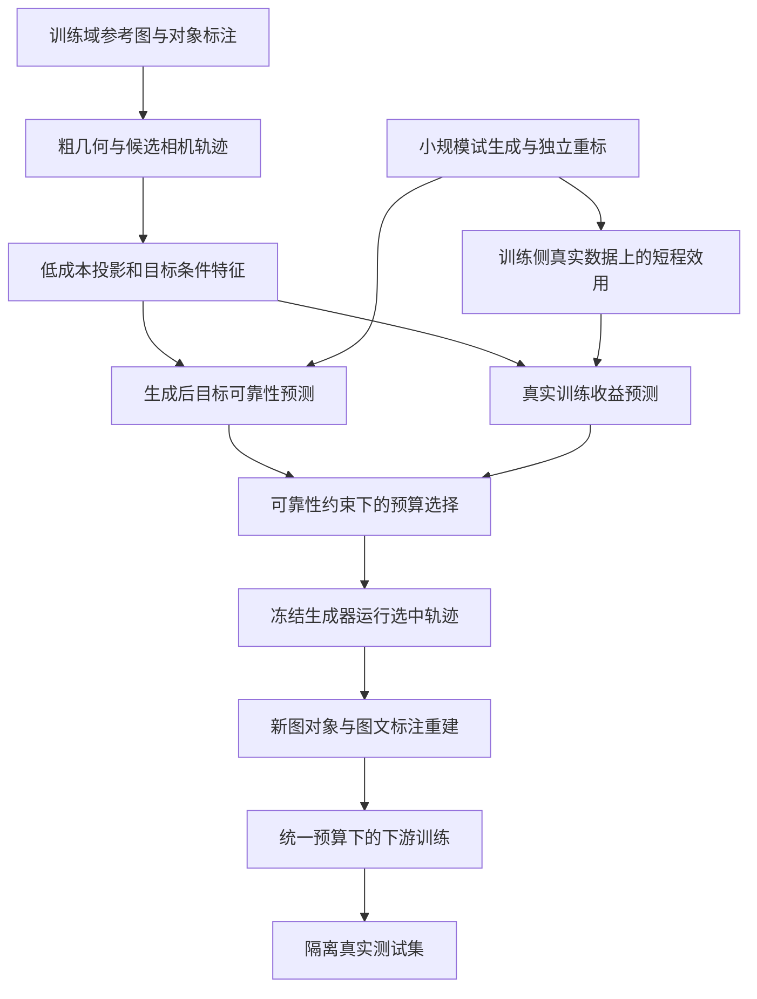

# 研究点一：调研结论与可执行 Idea

调研日期：2026-10-23。依据本次上传的《2534054陈阳鑫.pdf》，重点对应第 24–28 页 §4.1.2、第 27 页式 (4.6) 和第 42 页 §5.1。本文是研究建议，尚未进行所提方法的生成、训练或效果实验。

同日试跑补充：已完成 SHARP 与 MoGe-2 几何渲染路线的小样本可运行性验证，见 `outputs/open_source_trials_20261023/试跑报告.md`。这些结果用于选择基础工具，不构成本文所提可靠性约束、生成前效用预测或下游训练收益的验证。

同日第二轮补充：根据用户反馈，已执行更贴近任务一的 ViewCrafter 横向 30° / 俯仰 20° 航拍生成实验，见 `outputs/wide_view_trials_20261023/实验报告.md`。明显视角变化与小目标失真同时出现，后续应先完成目标可靠性审查。

## 1. 推荐方向

**建议题目：面向低空巡检的目标可靠性约束与训练效用驱动多视角图文扩增。**

英文工作题目：**Learning Which Views to Generate: Reliability-Constrained Augmentation for UAV Inspection**。

核心问题：给定一张或少量巡检参考图，在生成和标注预算有限时，能否在扩散生成之前，找出既能保留可监督目标、又能改善真实检测能力的新视角？

直观上，需要区分两类“难例”：

- **值得学习的困难观测**：车辆因合理视角变化变小或部分遮挡，类别仍可辨识，当前检测器容易漏检。
- **不适合当作同场景目标监督的生成失败**：车辆被画坏、消失、换了类别，或原本无法确认的细节被补成了看似确定的内容。

低检测置信度可能同时来自这两种情况。只挑低置信度样本容易选中生成错误；只挑清晰、可见性高的图，又可能不断生成检测器已经会识别的样本。因此，建议把**目标监督的可靠性**和**训练价值**分开建模，再在可靠候选中选择能补足真实模型能力缺口的视角。

这仍属于报告的“同场景视角选择与训练扩增”，质量判断仅服务于候选准入，不另开通用图像质量评价方向。

## 2. 与当前报告、历史方案的关系

当前报告已经明确了三个重要边界：生成器采用 ViewCrafter 一类场景级方法；原图二维框不能直接继承；生成样本仅进入训练，最终在隔离的真实图像上评价。

报告式 (4.6) 采用：

\[
J(c\mid S)=\lambda_V V(c)+\lambda_Q Q(c)+\lambda_D D(c,S).
\]

它衡量可见性、目标投影尺度与视角覆盖，是合理的起点。但它不能直接回答：一个几何上合适的视角是否会被生成器正确实现，以及它是否值得占用训练预算。

工作区 2026-10-15 的方案已经提出“生成前训练效用预测”。本次建议沿该方向收敛，补充直接相关文献，并将需要验证的机制明确为：

1. 源目标的几何可见，不等于生成后目标的可监督性。
2. 模型识别困难，不等于加入样本后会改善真实泛化。
3. 在目标可靠性约束下，生成前效用排序能否优于报告评分、困难样本采样及生成后过滤？

不要把已有的效用学习概念重新包装为首次提出，也不要把“加一个可靠性分数”本身写成充分创新。论文价值需要来自可验证的预测机制、泛化能力和完整成本收益。

## 3. 本轮调研中最影响选题的相关工作

| 工作 | 已有内容 | 对本研究的约束或启发 |
|---|---|---|
| DANR，2021 [1] | 已研究通过可微神经渲染生成新视角和对应框，用于目标检测扩增 | “新视角生成用于检测”不是新问题，必须纳入直接相关工作 |
| ViewCrafter，TPAMI 2025 [2] | 粗点云条件的视频扩散；§3.4 已有基于缺失区域的下一视角规划 | 不能把一般相机规划或适度遮挡控制作为新贡献；它适合做冻结生成器 |
| VISTA，CoRL 2024 [3] | 用单图新视角合成增强机器人策略的视角泛化；§4 已采用 LPIPS 拒收与重采样 | “NVS 扩增 + 质量过滤”也已有先例；可借鉴其随机视角与过滤对照 |
| InstaGen，CVPR 2024 [4] | 将实例 grounding head 接入扩散模型，生成带实例定位的检测数据 | 自动生成框、类别文本与区域对齐不是独立新意 |
| AeroGen，CVPR 2025 [5] | 面向遥感检测的水平框/旋转框条件生成、多样性条件和过滤 | 需要解释为何使用同场景视角变化能提供布局生成之外的价值 |
| Diffusion Curriculum / DisCL，ICCV 2025 [6] | 根据训练阶段和困难样本选择图像引导强度，调整合成数据学习过程 | “由模型弱点指导扩增”“由易到难”已存在，不能单独作为创新 |
| Coverage Optimization for Camera View Selection，CVPR 2026 [7] | 用覆盖准则选择重建视角，研究固定和具身数据获取 | 应比较几何覆盖，但其优化对象与真实巡检检测训练效用不同 |
| PR-IQA，CVPR 2026 [8] | 用其他位姿参考图评价生成新视角质量，并筛选 3DGS 监督区域 | 生成后跨视角质量评价已有直接工作；应增加质量过滤基线 |
| GRAD-MATCH，ICML 2021 [9] | 基于训练/验证梯度匹配选择数据子集 | 梯度效用代理必须引用已有基础，不能声称梯度内积原理是新方法 |
| OntoAug，CVPR 2026 [10] | 区分主体和环境，以布局和掩膜约束主体语义、扩展背景 | “保持对象、改变环境”也不足以成立为独立创新 |

另外核对了 SemanticNVS（2026 预印本）[11] 和 Stabilizing Camera-Controlled Novel View Synthesis at Inference Time（2026 预印本）[12]。前者研究语义条件改善远视角生成，后者研究小步相机运动和推理稳定性。二者说明“加语义条件”“缩小相机步长”都应先作为已有手段。

**从这些工作推导出的选题空间**：面向巡检小目标，在生成前联合预测“生成后是否仍有可靠目标监督”和“加入训练是否能改善真实任务”，并以固定预算验证选择价值。这里的“空间”是本轮检索后的研究判断，不是已经证明无人做过的结论。

## 4. 核心假设：有用的视角存在于两种失败之间

| 候选情况 | 目标监督可靠 | 目标监督不可靠 |
|---|---|---|
| 当前模型已经容易识别 | 可用，但可能重复、增益低 | 可能在学习伪影或错误外观，优先排除 |
| 当前模型识别困难 | 重点研究的候选，但仍需验证训练收益 | 不能仅因低置信度就当成高价值难例 |

例如，参考图中有一辆停在道路旁的车：

- 小幅转动后，车仍然很大、清晰，和已有训练样本相似：可靠，但可能没有新增训练价值。
- 适度改变俯仰和观察方向，车变小、受到合理遮挡，人工仍能确认类别：可能弥补小目标/遮挡条件下的漏检。
- 进一步改变视角，车被生成器画成一团纹理：检测器置信度更低，但这不能说明它是更好的训练样本。

这里“适度”不能设为所有场景通用的角度阈值。它取决于参考图覆盖、目标大小、几何质量、生成器能力和当前检测器状态。方法应学习这种条件关系。

## 5. 方法设计

### 5.1 输入输出与主干

输入：训练场景参考图、源目标标注、相对相机条件、冻结的场景生成器、训练侧检测模型，以及生成和标注预算。

输出：选中的相机轨迹、生成图、重新标注的目标框/可见性，以及由新标注构建的区域描述和问答。

第一版固定生成器和检测器初始检查点。暂不引入强化学习、端到端反传穿过视频扩散或多轮自进化；先让一次选择的收益可归因。

### 5.2 生成前能看到哪些信息

先在粗点云上渲染候选轨迹，获得便宜的条件特征：

- 类别、源图目标大小，以及新视角中预测的像素尺度、截断和遮挡。
- 目标附近点云的可靠性、有效投影覆盖、深度/焦距扰动后的投影变化。
- 轨迹相对方位、俯仰、归一化半径变化，以及每个预定保留帧的条件。
- 真实训练侧检测器的类别、尺度、遮挡分层错误；候选预计能补足哪些条件。
- 与已选轨迹的相似性、每个场景的已用预算和估计标注成本。

源框内包含背景，不能把整个框内的深度都视为目标表面。优先采用实例掩膜或明确的不确定目标代理；没有可靠目标几何时允许跳过。

未知位姿单图只能提供近似相对几何，不能把归一化半径变化写成真实飞行高度。候选渲染的孔洞也不能直接当成检测模型的真实能力缺口。

### 5.3 第一项预测：生成后目标监督是否可靠

在小规模试生成池中，为预先指定的源目标记录：新图中类别是否可辨识、是否仍能对应源实例、是否合理出画或遮挡、是否发生明显类别/形状破坏。身份无法确认时单独记录，不强制标为正确或错误。

这些标签由人工复核或可控场景真值提供。检测器输出可以辅助标注，不能同时充当可靠性真值，否则会系统性排除检测器尚不会识别的有效难例。

用轻量模型从生成前特征预测上述状态或有效目标比例。主要约束是**场景目标在生成中能否保留为可核查监督**，不拟合一个泛化到所有图像的审美/画质分数。

预测器在独立训练侧场景上校准。可以把生成结果按“可靠保留、合理不可见、生成失败、身份不明”分开，而不是把所有未匹配对象记为消失。合理不可见仍可形成正确的新图描述，但不能被计为成功保留的正目标。

不同随机种子也会改变生成可靠性。试生成阶段对部分轨迹使用两个种子检查波动，并把这部分成本计入预算；主实验冻结生成器版本、采样参数和种子协议。

### 5.4 第二项预测：是否有真实训练收益

不能直接用“检测器越不确定越好”替代效用。建议在训练集合内部设置按场景隔离的三种职责：

| 子集 | 职责 |
|---|---|
| `real_core` | 训练初始检测器 |
| `proposal_train` | 提供试生成参考和候选轨迹 |
| `real_meta` | 用真实图像评价候选的短程训练效果 |

对已经试生成并独立重标的候选轨迹 \(j\)，从相同初始检查点出发，用其预定保留帧作少量更新，定义：

\[
u_j=L_{\mathrm{real\_meta}}(\theta)
-L_{\mathrm{real\_meta}}(\theta'_j).
\]

正值表示该短程更新降低真实训练侧损失。所有候选使用一致的真实样本混合、更新步数与优化设置。低成本版本只更新检测头；需要抽样验证它与较完整更新的排序一致性。

再训练一个轻量排序器 \(h_\psi(x_j, s_\theta)\)，由候选条件和当前检测器的能力摘要，预测候选效用。正式选择时只输入生成前信息。

可用梯度内积近似减少试验成本，但必须作为已有数据选择思想的应用，并与实际短程更新对照。短程损失下降不等于完整训练后的 AP 提升，后者仍是最终判断依据。

整个选择器只用训练侧数据拟合；外部开发集用于选超参数，最终测试不进入能力缺口统计、排序、阈值或生成过程。

### 5.5 预算内选择：先保证可靠，再比较效用

把报告的固定加权评分保留为直接基线。完整方法可写成：

\[
\max_{S\subseteq\mathcal C}
\left[\sum_{j\in S}\hat u_j-\lambda\,\mathrm{Redundancy}(S)\right],
\]

\[
\text{s.t.}\quad
\hat r_j\ge\tau,\quad
\sum_{j\in S}g_j\le B_g,\quad
\sum_{j\in S}a_j\le B_a.
\]

其中 \(\hat r_j\) 是经开发阶段校准的目标可靠性估计，\(\hat u_j\) 是预期训练效用，\(g_j,a_j\) 分别为生成和标注成本，冗余项避免反复选择同一种视角。

这样，高预计收益不会在加权和中无限抵消目标破坏风险。不过，阈值也可能错删有用样本，因此需要比较软惩罚与硬约束，绘制收益—可靠性—拒收率曲线。预测阈值不构成真实风险的数学保证；本方案不声称最优性或 AP 下界。

采用固定长度视频生成器时，以**整条轨迹**计生成费用，以提前选定的保留帧计标注费用。不能只按最终入选的几帧计算扩散成本。标签不足或无可行候选时允许不生成，记录缺额，不能无限免费重采。

### 5.6 图文部分：让视角变化对应可核查的语义变化

图文数据来自新图重建的对象集合，而不是原描述的直接复制。建议首轮只做类别、计数、图像位置和明确可见关系。

| 新视角状态 | 可用的监督 |
|---|---|
| 车辆仍可辨识，位置改变 | 更新框和区域指代表达，例如“图像右下方的车辆” |
| 一辆车出画，另外两辆可见 | 对当前画面生成“可见两辆车”，前提是全图已完整标注 |
| 类别可辨识，但细节过小 | 保留类别与位置，省略无法确认的颜色、损坏属性 |
| 目标严重模糊，无法辨别 | 区域 ignore，相关属性 unknown，避免强制正负标签 |
| 生成器凭空增加实例 | 单独记录为生成新增对象；不算源实例保持成功 |

对同一父场景的不同视角，可以构造“哪些描述保持、哪些需要更新”的配对样本。对象类别可能保持，但计数、左右位置和可见性通常不能要求恒定。配对用于分析和可选训练，不据此宣称已完成真实世界的因果识别。

图文贡献至少应有真实图像上的区域文本定位或计数问答评价。仅在合成图上算 CLIPScore，不能证明图文扩增改善了巡检理解。第一版采用模板生成与小型区域文本头即可。

## 6. 推荐先做的最小实验

### 阶段 A：确认问题是否实际存在

建议先选 20 个有源目标标注的训练场景，每场景 4 条受限轨迹，每条固定保留 4 帧：共 80 次轨迹生成、320 张待复核图。这是试验设计数量，不是已有数据。

观察三件事：

1. 报告的可见性/尺度评分与实际目标保留率是否存在明显不一致？
2. 低检测置信度中，有多少来自可学习难例，有多少来自生成破坏？
3. 生成图能否产生真实图所欠缺的有效目标条件，而不只是复制或缩放已有对象？

以目标为单位记录状态，以场景为独立统计单位。按尺度和类别分层，避免只看背景较好的大目标图。

若这一步发现绝大多数小目标都无法保留，应先缩小视角或更换生成器；此时不值得先训练复杂选择器。若清晰目标全部对应已会识别条件，也说明需要重新定义候选空间。

### 阶段 B：确认生成前排序是否能学到

视阶段 A 结果扩展至约 40–64 个场景、每场景 4 条轨迹、每轨迹 4 个保留帧，即约 640–1024 张复核图。按场景分组交叉验证；这些规模仅用于估计可行性，可能不足以训练可泛化的效用预测器。

先比较线性模型、树模型、小型 MLP。关注场景外效用排序、可靠性校准、保留率，以及在相同有效样本数下能否选到更有用的数据。

应保留一个“生成全部小候选池后，按实际效用选择”的昂贵参照。它帮助区分“候选本来没有价值差异”和“生成前预测没有学到差异”。它不参加等生成成本排名。

### 阶段 C：最少必要的下游对照

| 组别 | 对照内容 | 回答的问题 |
|---|---|---|
| R0 | 真实数据 + 常规二维增强 | 原始基线 |
| R1 | R0 + 真实困难样本重采样 | 是否无需生成就能得到相同收益？ |
| G0 | R0 + 等预算随机可行轨迹 | 新视角扩增本身是否有效？ |
| G1 | R0 + 报告式 (4.6) 的 V/Q/D 选择 | 是否超过当前报告方法？ |
| G2 | R0 + 几何覆盖或生成器原生规划 | 是否只是场景覆盖改善？ |
| G3 | R0 + 任务困难度选择 | 是否只是挑难例？ |
| G4 | R0 + 质量过滤/可靠性筛选 | 是否只靠去除坏图？ |
| Ours | R0 + 可靠性约束下的生成前效用选择 | 联合机制的净贡献 |

首轮可以先跑 R0、R1、G0、G1、Ours；完整论证补齐 G2–G4，并在输入/标注条件可适配时增加 AeroGen 等外部生成基线。不能直接把别人的论文数值与本方法排在一个表中比较。

所有生成组共用相同父图候选、标注规则和训练步数。生成后过滤基线的所有废图、重采样以及本方法前期校准池都计入实际成本。固定生成调用数与固定有效标注数是两种实验，失败率不同时不能混称完全等预算。

## 7. 数据、资源与评价

主任务先聚焦公开低空航拍数据支持的人员/车辆检测。裂缝、渗漏、腐蚀和复杂风险关系需要专门数据，暂不作为这一 Idea 的起步条件。

| 数据 | 用途 | 限制 |
|---|---|---|
| VisDrone | 真实检测训练和测试；源图标注 | 不默认有相机参数、可靠跨视角实例身份或风险标签 |
| MatrixCity | 已知相机下投影与生成几何验证 | 合成域，不替代真实检测收益；对象标注需另核查 |
| UAVDT | 交通类别跨域验证候选 | 与 VisDrone 类别并非完全一致，需预先固定映射 |
| 真实图文补标子集 | 区域文本定位、计数问答 | 与生成训练父场景隔离，保持完整对象标注 |

沿用公开划分时仍检查同地点、相邻帧和不同任务共享图像的泄漏。所有生成后代继承父场景划分。真实视频中的移动对象不能直接作为静态新视角真值。

当前设备查询为 RTX 4090，约 24GB 显存。ViewCrafter 官方 README 的参考值为：16 帧、576×1024、50 步、逐帧 AE 解码，在 **A100 40GB** 上约 18.3GB 显存、75 秒。它说明有单卡试跑的可能性，不能据此承诺 4090 时延。16 帧权重属于官方消融版本，报告时须注明。

建议冻结生成器，先离线生成、再训练检测器、最后训练图文小头，顺序使用显卡。当前工作区常见路径下未发现 ViewCrafter 代码、运行环境和数据目录；历史文档中的下载/实验记录不能视为当前环境已就绪。

评价应包括：

- 真实检测 AP、APsmall、遮挡分层召回，至少 3 个训练种子。
- 真实图文定位 Acc@IoU≥0.5、计数问答准确率；另报 unknown/拒答覆盖。
- 目标可靠性预测的校准和保留率；效用排序的场景外相关性。
- 几何验证集上的相机遵从性和目标保持，避免用背景质量掩盖目标丢失。
- 累计 GPU 小时、人工标注时间、失败率和实际可用样本数量。

以场景组做配对统计，不把同一轨迹的多帧视为独立重复。所有数值提升目标都应在预实验后登记，不预写结果，也没有“提升若干 AP 就能中某会议”的门槛。

## 8. 最关键的反证与停止条件

1. **可靠性预测无法跨场景工作**：应回到透明的几何过滤，不能声称学会了目标可生成性。
2. **效用排序不优于报告评分**：说明预测机制未成立，应保留负结果，避免扩大生成量掩盖问题。
3. **真实困难样本重采样效果相同**：需要证明新视角提供了新增监督，否则生成成本没有合理性。
4. **可靠性过滤单独就解释全部增益**：收窄到有效样本准入，不再声称学习效用选择是核心。
5. **完整计费后没有效率优势**：可以研究质量，但应取消节省预算的主张。
6. **只有合成域或生成图评价改善**：不足以支持真实巡检扩增有效。

如果条件满足，适合主张的贡献是：一种面向小目标的生成前视角选择机制；关于几何可见性、生成可靠性和真实训练收益之间差异的系统证据；以及由新视角标注重建得到的图文扩增及真实任务评价。创新性仍须在实现后与更完整的同期文献比较。

## 9. 可用于修改报告的研究表述

> 针对低空巡检多视角样本扩增中几何可见性与实际训练收益不一致的问题，研究目标可靠性约束的训练效用驱动视角选择方法。基于参考观测、粗几何和候选相机条件，利用小规模试生成及真实训练侧反馈，分别预测新视角中目标的可监督性与样本的预期训练效用，在生成与标注预算约束下选择互补视角；随后依据生成图中的实际可见对象重新建立框、属性及图文关系，并在按场景隔离的真实巡检数据上验证检测、图文理解和成本收益。

该段使用“研究”“预测”“验证”，不把计划写成已取得的成果。原式 (4.6) 建议保留为起步方法和关键对照。

## 10. 来源与阅读范围

本轮读取了最新上传报告的文本；精读了 ViewCrafter 的点云构建与轨迹规划、DANR 的方法概述、VISTA 的扩增与拒收流程；其余下列工作主要核对官方论文页摘要。检索覆盖 CVF 的 ICCV 2025、CVPR 2026 目录及 arXiv 主题查询，不是穷尽所有 2026 年文献的系统综述。搜索引擎部分不可用或结果无关，因此采用论文站点和 arXiv 交叉查找。

1. **DANR — Data Augmentation for Object Detection via Differentiable Neural Rendering**，2021。[arXiv](https://arxiv.org/abs/2103.02852)。已读 PDF 摘要、引言和方法概述；此处未另核定正式发表场所。
2. **ViewCrafter: Taming Video Diffusion Models for High-fidelity Novel View Synthesis**。[论文](https://arxiv.org/abs/2409.02048)、[官方代码与资源表](https://github.com/Drexubery/ViewCrafter)。TPAMI 2025 标注来自官方仓库；已读论文 §3.2、§3.4。
3. **View-Invariant Policy Learning via Zero-Shot Novel View Synthesis / VISTA**，CoRL 2024。[论文](https://arxiv.org/abs/2409.03685)。已读 PDF §4；CoRL 信息见 PDF 首页。
4. **InstaGen: Enhancing Object Detection by Training on Synthetic Dataset**，CVPR 2024。[CVF](https://openaccess.thecvf.com/content/CVPR2024/html/Feng_InstaGen_Enhancing_Object_Detection_by_Training_on_Synthetic_Dataset_CVPR_2024_paper.html)。已核对正式摘要。
5. **AeroGen: Enhancing Remote Sensing Object Detection with Diffusion-Driven Data Generation**，CVPR 2025。[CVF](https://openaccess.thecvf.com/content/CVPR2025/html/Tang_AeroGen_Enhancing_Remote_Sensing_Object_Detection_with_Diffusion-Driven_Data_Generation_CVPR_2025_paper.html)。已核对正式摘要。
6. **Diffusion Curriculum: Synthetic-to-Real Data Curriculum via Image-Guided Diffusion**，ICCV 2025。[CVF](https://openaccess.thecvf.com/content/ICCV2025/html/Liang_Diffusion_Curriculum_Synthetic-to-Real_Data_Curriculum_via_Image-Guided_Diffusion_ICCV_2025_paper.html)。已核对正式摘要。
7. **Coverage Optimization for Camera View Selection**，CVPR 2026。[CVF](https://openaccess.thecvf.com/content/CVPR2026/html/Chen_Coverage_Optimization_for_Camera_View_Selection_CVPR_2026_paper.html)。已核对正式摘要；arXiv 与 CVF 摘要中的方法缩写不同，正文使用完整题名。
8. **PR-IQA: Partial-Reference Image Quality Assessment for Diffusion-Based Novel View Synthesis**，CVPR 2026。[CVF](https://openaccess.thecvf.com/content/CVPR2026/html/Choi_PR-IQA_Partial-Reference_Image_Quality_Assessment_for_Diffusion-Based_Novel_View_Synthesis_CVPR_2026_paper.html)。已核对正式摘要。
9. **GRAD-MATCH: Gradient Matching based Data Subset Selection for Efficient Deep Model Training**，ICML 2021。[PMLR](https://proceedings.mlr.press/v139/killamsetty21a.html)。已核对正式摘要。
10. **OntoAug: Rethinking Generative Data Augmentation via Ontology Guidance**，CVPR 2026。[CVF](https://openaccess.thecvf.com/content/CVPR2026/html/Wang_OntoAug_Rethinking_Generative_Data_Augmentation_via_Ontology_Guidance_CVPR_2026_paper.html)。已核对正式摘要。
11. **SemanticNVS: Improving Semantic Scene Understanding in Generative Novel View Synthesis**，2026 预印本。[arXiv](https://arxiv.org/abs/2602.20079)。已核对摘要，不据此赋予正式会议归属。
12. **Stabilizing Camera-Controlled Novel View Synthesis at Inference Time**，2026 预印本。[arXiv](https://arxiv.org/abs/2609.03639)。已核对摘要，不把其特定实验中的角度结果当作巡检场景阈值。

上述来源支撑对已有工作的描述；推荐方法、预算设计和实验决策是本次分析提出的研究方案，尚无结果。
